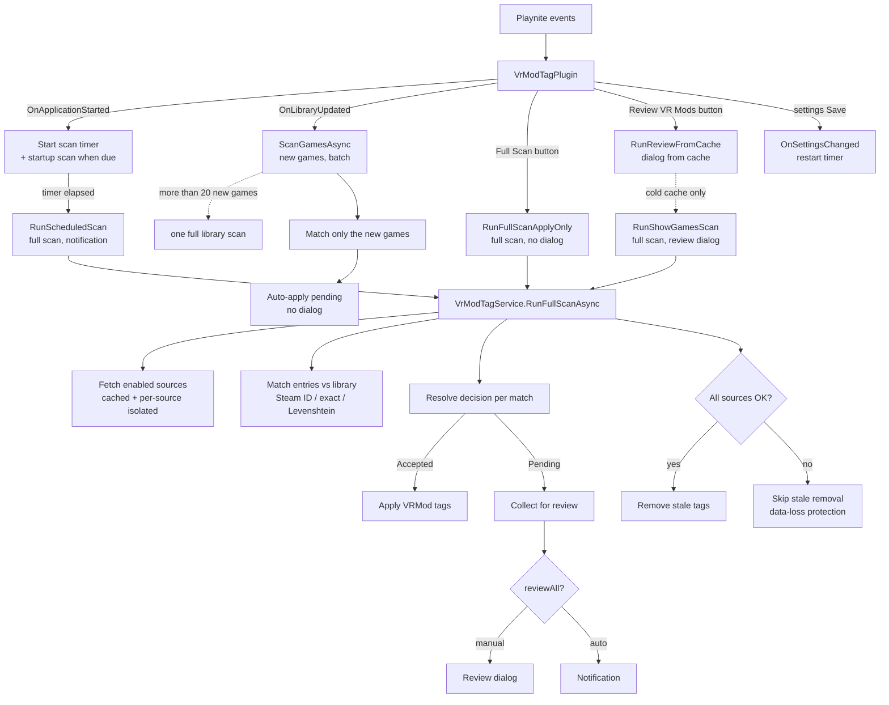
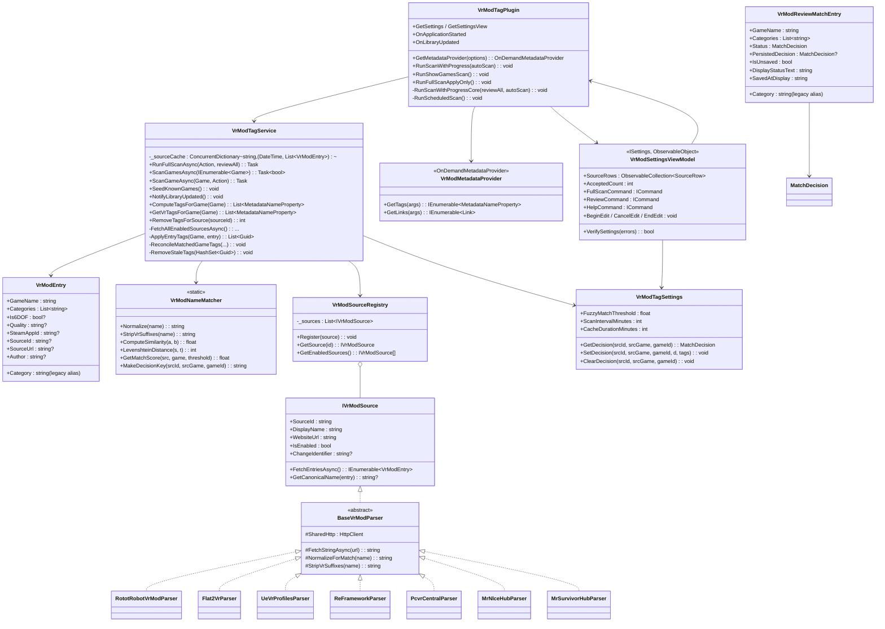

# Architecture — Playnite VR Mods Tag Plugin

A Playnite extension (`.pext`, `MetadataProvider` type) that scans a small set of
community-maintained "VR mod" sources, matches them against the games in the user's
Playnite library, and — after the user confirms — writes VR-related **tags** onto those
games. It is built on top of the Playnite SDK (no Playnite core is modified).

**How to read this document.** A new developer should read it in order:

1. **Start here** — the mental model: what the plugin does, the five objects to keep in
   mind, the tag vocabulary, and how one scan flows end to end.
2. **The scan flow** — the overview flowchart plus the two sequence diagrams
   (full scan and single-game scan).
3. **Matching** and **Decisions & persistence** — the two algorithms that decide *which*
   games get tagged and *who gets to decide*.
4. **The review dialog** — the UI where the user makes those decisions.
5. **Object model** — the class diagram (a map, not a manual — read the code for bodies).
6. **Unusual things to know** — the project-specific gotchas that are not obvious from
   the code.
7. **Reference** — per-class deep dives, the source implementations, the settings view,
   the database layout, the manifest, the build, the constraints, and the file tree.

The README (repo root) is user-facing; `database.md` documents the Playnite DB layout in
full; `external-references.md` is the source-research trail. `AGENTS.md` (project root,
repo) covers build/agent conventions.

**Where the tests live.** `tests/Unit/` (54 files) is everything that runs without Playnite's
PMW wrapper plus the parser plumbing tests — `BaseVrModParserFetchTests`,
`BaseVrModParserFetchFailureTests`, `PcvrCentralParseResilienceTests`,
`UeVrProfilesFirebaseConfigTests`. `tests/Parsers/` (12 files) holds one behavioural suite per
source (`PcvrCentralParserTests`, `VorpXParserTests`, …) that asserts what a given site's HTML
turns into. `tests/Integration/` (12 files) is the PMW-wrapped end-to-end surface. So a parser
is usually covered from two folders, and the name of the test file says which slice it is.

---

## Start here

### What the plugin does

Playnite games are tagged (with `VRMod`, `VRMod {category}`, and optional facet tags)
when a community source says that game has a VR mod, **and** the user has accepted the
match. The plugin runs in the background on a timer (auto-scan) and on demand from the
settings page (manual scan). The matching is deliberately conservative: it never tags a
game on a plain substring, and every match starts *Pending* until the user sees it in
the review dialog and accepts it. Accepted / Rejected decisions are persisted so the same
game is not asked about twice.

### The five objects to keep in mind

| Object | Type | What it is |
| --- | --- | --- |
| **Source** | `IVrModSource` (+ `BaseVrModParser`) | One external site/API. Twelve registrations from eleven parser classes (`VrModTagPlugin.cs:119-136`; `SteamCuratorParser` is registered twice, for two curator feeds). Has an `IsEnabled` the user toggles and a `ChangeIdentifier` for caching. |
| **Entry** | `VrModEntry` | One source's claim about *one* game: name, a set of categories, optional Steam App ID, optional 6DOF/quality facet, optional per-entry page URL. |
| **Match** | `VrModReviewMatchEntry` | A source **Entry** joined to a **Playnite `Game`**. The single source of truth is its `Status` (`Pending`/`Accepted`/`Rejected`). |
| **Decision** | `MatchDecision` (enum) + a string **key** | What the user decided about a match. Persisted in `config.json`, keyed by (source, listing **identity**, game **Id**) — per mapping, not per category (see *Decisions & persistence*). |
| **Tag** | Playnite `Tag` | The persisted output. Umbrella `VRMod`, category `VRMod {category}`, facets `VRMod 6DOF` / `VRMod {quality}`. |

Everything else is plumbing around these five.

### The tag vocabulary

Tags written to the DB (all carry the `VRMod` prefix so they are easy to find and safe
to clean up):

- **Umbrella** `VRMod` — always added to every matched game.
- **Category** `VRMod {category}` — e.g. `VRMod UEVR`, `VRMod Flat2VR Port`,
  `VRMod REFramework`. One per known category on the entry, except **catalog** categories
  (`IsCatalogCategory`, `VrModCategories.cs:199-203`: PCVR Central, PCVR Mods Hub,
  Mr Survivor, CompoundVR), which contribute no category tag of their own — only the
  umbrella (see "Cross-source overlap" below). An enriched catalog source can still emit
  *framework* categories alongside its catalog category: PCVR Central's per-game `mods` array
  yields `VRMod UEVR` / `VRMod Dedicated` / `VRMod VorpX` / `VRMod UUVR` / `VRMod Depth3D` …
  while its own `PcvrCentral` category stays tag-free (see **PCVR Central enrichment** under
  *Per-source notes*).
- **Facets** (optional, orthogonal to category): `VRMod 6DOF`, `VRMod First Person`,
  `VRMod Third Person` (fixed tag names), plus one tag per known **quality** grade
  (`Native-like`, `Excellent`, `Playable`, `Experimental`), per known **motion level**
  (`Full Motion`, `Partial Motion`, `Gamepad Only`, `No Motion`) and per known **mod status**
  (`Active`, `Update Detected`, `Outdated`, `Broken`, `Abandoned`) — `TagNameForQuality` /
  `TagNameForMotion` / `TagNameForStatus`, applied by `VrModCategories.TagNamesFor`
  (`VrModCategories.cs:259-297`).

**One vocabulary, checked in one place.** `VrModCategories.KnownTagValues`
(`VrModCategories.cs:102-114`) is the list of every value the plugin may turn into a
`VRMod {value}` tag: the category constants (frameworks, the four catalogs, Full Motion
Controls, Motion Gesture, Head-Tracked), the four quality grades, the four motion levels, the
five mod statuses, and the three fixed facet values. Tag names are built
by concatenating a value that a website wrote onto the umbrella prefix, so the check exists to
stop a parser forwarding raw page text (a mod title, an HTML fragment, a 200-character
description) from becoming a tag in the user's library (`IsValidTagName`,
`VrModCategories.cs:153-166`). An off-vocabulary value is **dropped and reported**:
`DropUnknownFeatureValues` collects them with `UnknownTagValues`
(`VrModCategories.cs:131-144`), removes them from the entry, logs the dropped values, and puts
the same line in that source's run log (`VrModTagService.cs:300-325`) — so a site renaming its
categories shows up in the log instead of looking like games quietly losing category tags. See
also **Source category allow-lists** below.

Tag *presence* means "accepted for this game"; the per-decision detail (which source,
when, by whom) lives in `config.json`, not on the tag.

### How a game's tags combine (union-all)

A game's tag set is the **union** of every tag yielded by every matched entry (every mod,
from every source), deduplicated by tag name. There is **no single-value constraint across
a game**: it can carry several **categories** (a `UEVR` profile *and* a `VorpX` mod *and*
full motion), several **quality grades** (two mods graded differently), several **mod
statuses** (one mod still `Active`, another `Outdated`), and even
**conflicting facets** (`VRMod First Person` *and* `VRMod Third Person`) — all coexist.
The governing rule is **union-all**: *every tag a source yields is applied to the game;
conflicting values are both kept.* (Same rule at the source level: "Cross-source overlap"
below.)

A status set mixing `Active` with `Broken` is not a contradiction to resolve: it means the game
has a working mod *and* a broken one, which is the choice the user is making. It is also why the
majority status (`Active`, on 1,527 of PCVR Central's 1,548 mods) is kept rather than dropped — a
game with **no** status tag then means "no source says anything about this mod", which is a
different fact from "a source says it works". Which mod each status belongs to is not recoverable
from the tag list; it is kept in `VrModEntry.AdditionalInfo`, where PCVR Central writes a per-mod
feature summary (`source/Parsers/PcvrCentralParser.cs:594-685`).

Within one **entry** the categories are a **set** (`VrModEntry.Categories`): a single mod
can yield several categories (e.g. a RototRobot mod that is both a UEVR profile *and* a
full-motion rig yields `VRMod UEVR` *and* `VRMod Full Motion Controls`). `Category` remains
a legacy single-value alias (writing it appends to `Categories`); `Categories` is the source
of truth. The same applies to the graded facets: `Qualities`, `Motions` and `Statuses` are collections and
`Quality` / `Motion` (`VrModEntry.cs:167`, `:186`) are their legacy single-value aliases, so
one entry can carry several grades and several motion levels. `Is6DOF` / `IsFirstPerson` /
`IsThirdPerson` (`:121`, `:129`, `:137`) stay one-valued per entry — they are yes/no answers, and both
yes and no add a tag. This is the **flat tags** model: a mod is a *set of tags* with no
first-match-wins category collapse (see the RototRobot fix below).

### Two scans, two triggers

| Scan | Method | Trigger | Result surface |
| --- | --- | --- | --- |
| **Full scan** | `VrModTagService.RunFullScanAsync` | Scan timer; Playnite startup (`ScanOnStartupAsync` — first install, expired cache, or cache disabled); the **Full Scan** and **Review VR Mods** buttons, which live on the plugin's own settings page — Playnite shows that page under **Add-ons →
   Extensions settings** for this plugin; the plugin defines no Playnite `CommandDefinition`s | Timer → a Playnite **notification**. **Full Scan** → tags applied (no dialog). **Review VR Mods** → the **review dialog** built from the source cache (no scan); only a cold cache falls back to a full scan with `reviewAll: true`. |
| **New-game scan** | `VrModTagService.ScanGamesAsync` (batch; `ScanGameAsync` is the one-game case) | Two paths: `OnLibraryUpdated` → `NotifyLibraryUpdated` (diff against the known-game baseline), **and** the service's own `Database.Games.ItemCollectionChanged` / `ItemUpdated` subscriptions (`VrModTagService.cs:1648-1649`) — the latter is what catches a manually added game, which never raises `OnLibraryUpdated`. Batches are debounced 5 s (`DefaultNewGameDebounceMs`); more than `MaxPerGameScanBatch = 20` games in one batch runs **one full library scan** instead of a per-game scan. | Pending matches are **auto-applied** (tags written now, no dialog) — a game appearing in the library is not a moment to interrupt the user. The decision stays **Pending** (defined below). |

> **"Auto-applied", precisely (single-game scan):** the match's **tags** are written to
> the game immediately — so the tags are visible without a dialog — but the match's
> **decision** is left **Pending**; it is *not* saved as accepted. The game therefore
> shows the VR mod tags now, but the match reappears as a **Pending** row in the next
> full-scan review, where the user confirms it (→ accepted, and a source link is added)
> or rejects it (→ tags removed). Until confirmed, the game carries the tags but **no
> source link**.

The **Review VR Mods** button opens the review dialog **without scanning**:
`VrModTagService.BuildReviewMatchesFromCache` recomputes the rows purely from the
in-memory source cache — no network, no progress window — so the dialog shows **every**
matched game (new and already-decided) with pending sorted to the top. Only when no
source has cached data at all (a cold start, before the startup scan has populated the
cache) does it fall back to the *full* scan with `reviewAll: true`. The **Full Scan**
button runs the scan with no review callback (auto-applies the matches, no dialog). The
timer runs it with `reviewAll: false` (pending only) and posts a notification instead of
opening a window.

### How a scan flows

1. Playnite raises a start event (startup, settings button, timer, or a library update
   that added new games).
2. `VrModTagPlugin` dispatches to `VrModTagService`: full scan, or the new-game batch
   scan (`ScanGamesAsync`) for the games a library update just added.
3. For each **enabled** source the service fetches entries once
   (`FetchAllEnabledSourcesAsync`). Entries are cached per `SourceId` and served until
   `CacheDurationMinutes` expires; `ChangeIdentifier` decides the **source-status**
   change ("source changed since last scan"), not cache validity. Every request goes
   through `HttpHostGate` (4 requests in flight overall, 1 per host) and `RobotsPolicy`
   (crawl-delay honoured). **Each source is isolated** so one failure
   neither cancels the others nor corrupts their tags (see the data-loss gate below).
4. Each entry is matched against the library: Steam App ID → exact normalized name →
   length-bounded Levenshtein (never a plain substring). A score below
   `FuzzyMatchThreshold` is a non-match, and only a score of exactly `1.0` (identical
   after normalization, or a shared normalized source identifier) is auto-Accepted —
   every other match is Pending.
5. Each match is checked against the **decision already stored for that pair** (this game +
   this source entry). A stored **Accepted** is applied again without asking; a stored
   **Rejected** is skipped and gets no tags; a pair the user has never decided on is
   **Pending** - the plugin has no opinion about it yet, and "Pending" is a stored state,
   not a transient one.
6. **Accepted** matches get their tags (and the entry's source deep link) applied to the
   game. **Pending** matches are collected for the review callback (dialog or notification)
   and otherwise change nothing - except in the new-game scan, where a Pending match's
   **tags** are written immediately while its decision stays Pending (see
   "Auto-applied, precisely" above).
7. After all sources, **stale tags** are removed — *but only if every enabled source
   succeeded*; if any source failed, removal is skipped (data-loss protection).
8. The pending list (or, for `reviewAll`, the full list) is handed to the review
   callback: a notification (auto) or the review dialog (manual).

> **The auto-scan notification.** The timer scan posts one Playnite
> notification — per-source failures and stale-removal skips, otherwise the number of
> pending matches (`BuildScanNotificationMessage`; the dialog title names it a scheduled
> scan) — and clicking it opens the **review dialog** for that scan's pending matches.
> When the scan produced no pending matches the click target is `null`: the notification
> is informational and opens nothing. There is no "no news → settings view" target in
> the code, and the **Full Scan** button posts no notification at all.

---

## The scan flow

### Overview



**Diagram detail policy.** Orientation diagrams (this one, the sequences below) stop at
the *flow* and *object* level — they name the moving parts and the branch points, not the
per-class API surface. The exhaustive method/field list is the **class diagram** and,
ultimately, the code; do not expect a diagram to be a complete reference.

### Full scan (`RunFullScanAsync`)

```mermaid
sequenceDiagram
    participant P as VrModTagPlugin
    participant S as VrModTagService
    participant R as VrModSourceRegistry
    participant SRC as IVrModSource (each)
    participant DB as PlayniteApi.Database
    participant U as Review dialog / notification

    P->>S: RunFullScanAsync(reviewCallback, reviewAll)
    S->>S: TryBeginScan() [gate: one scan at a time; a coinciding trigger is skipped]
    S->>S: Build game index (BuildGameIndex)
    S->>R: GetEnabledSources()
    loop Each enabled source
        S->>SRC: FetchEntriesAsync() [cached, per-source isolated]
        SRC-->>S: IEnumerable<VrModEntry>
        loop Each entry
            S->>S: Match (Steam ID / exact / Levenshtein)
            alt Accepted (existing decision)
                S->>DB: Apply tags
            else Pending (new)
                S->>S: Add to pending list
            end
        end
    end
    S->>S: RemoveStaleTags (only if all sources OK)
    S-->>P: Pending matches via callback
    alt reviewAll (manual)
        P->>U: Review dialog (all matched, pending first)
    else auto (timer)
        P->>U: Notification (new matches)
    end
```

### Single game scan (`ScanGameAsync`)

```mermaid
sequenceDiagram
    participant P as VrModTagPlugin
    participant S as VrModTagService
    participant R as VrModSourceRegistry
    participant SRC as IVrModSource (each)
    participant DB as PlayniteApi.Database

    P->>S: ScanGameAsync(game)
    S->>S: TryBeginScan() [gate; skipped if a scan is already running]
    S->>S: Fetch cached entries (if fresh)
    loop Each entry that matches this game
        S->>DB: Apply tags (auto, no review)
    end
    Note over P,S: Pending matches from a single-game scan are auto-applied (tags now, decision stays Pending — not accepted, no source link), not shown in a dialog
```

---

## Matching (no substring)

`VrModNameMatcher` is a static utility shared by the service and every parser; it only scores
name pairs. The
tiers themselves are the service's lookup, `FindGamesByIndex` (`VrModTagService.cs:720-782`),
and **a plain substring is never a match** (this is what eliminates the sequel false positives
— `hl` must not match "Half-Life 2"):

1. **Steam App ID** — `_steamCache` maps an App ID to a game, built from each Playnite game's
   `Links` that start with `https://store.steampowered.com/app/` (`VrModTagService.cs:578-588`);
   an entry carrying the same `SteamAppId` gets that game added directly (`:725-729`). A perfect
   hit with no name involved. An entry whose App ID the library has no link for is **not** stuck:
   name matching still runs below it.
2. **Exact normalized name** — normalized source name equals normalized game name → every game
   sharing it, i.e. store duplicates, and the lookup stops there (`:736-741`). Two normalizers
   are in play: `VrModNameMatcher.Normalize` (strip VR suffixes, lowercase, `-`/`_` → space,
   remove `.`, trim) and the index-side `VrModTagService.NormalizeForMatchFast` (drops
   everything but letters/digits/spaces, collapses runs); the differential test locks them to the
   same result.
3. **Length-bounded Levenshtein** — only when no exact name hit: the best-scoring normalized
   name among the candidates sharing its 3-character bucket prefix (`HashBucketChars`,
   `:746-753`), and every game sharing *that* name (`:774-779`). Score = `1 - dist/maxLen`,
   returned only if ≥ the caller-supplied `threshold` (`FuzzyMatchThreshold`, default `0.75f`,
   validated to 0.50–1.00).

`GetMatchScore(sourceName, gameName, threshold)` (`VrModNameMatcher.cs:299`) returns the best
score of a pair, or `-1` for no match. `Normalize` / `StripVrSuffixes` clean names;
`MakeDecisionKey` builds the persistence key (see below).

The **other direction** — which cached entries could match a given game, which is what the
review dialog and the reconciliation passes ask — does not scan names at all. It queries the
catalog index (`GetCachedEntriesForGame`, `VrModTagService.cs:2938-2965`), whose prunes are
derivations of the matcher's own: a length window derived from the threshold (`:2946-2949`) and
a letter-overlap upper bound (`:2957`), each with a one-character margin so float rounding
never decides a match, then `CanReachSimilarity` (`1 − |Δlength|/maxLen` must reach the
threshold, `VrModNameMatcher.cs:358-365`).

The legitimate fuzzy matches (anything below a perfect 1.0) are *expected*, but they are
never auto-accepted: `score >= 1.0f` is what makes a match Accepted (`VrModTagService.cs:931`,
`:1114`, `:1429`); everything else is a **Pending** row for the user to confirm.

One source entry can match several `Game` rows: a title imported from several stores
yields several rows with an identical name. `FindGamesByIndex` returns all of them
(exact and fuzzy paths alike), and each duplicate becomes its own review row and its
own decision.

### Name runs, and the suggestions they produce

The tiers above answer one question: *may this listing be tagged as this game*. They cannot
answer the other question a user has — *is there a game in my library this listing is about,
that the lookup cannot see*. Two live cases show the gap: *Age of Wonders 3* (a PCVR Central
listing) against *Age of Wonders 4 Golden EDITION* (a library game), and a GOG copy of *The
Elder Scrolls III: Morrowind GOTY Edition* against a listing called just *Morrowind*. The first
is refused by the hard exclusions, the second never becomes a candidate at all — the listing
name is a prefix of the *middle* of the game name, so it is in neither 3-character bucket. Only
the second shape reaches a review row: a name disagreement is a refusal, and it stays one.

Rather than widen the tiers, this is a **second lookup with its own verdict and its own rules**,
whose output is never applied:

1. **`VrModTokenRun` / `CompareTokenRuns(sourceName, gameName)`** (`VrModTokenRun.cs`,
   `VrModNameMatcher.cs`) classifies a normalized pair as `Unrelated` / `SameProduct` /
   `NeedsALook` / `DifferentProduct`. A *run* is the maximal leading stretch of *word tokens* that occurs in both
   names (`VrModWordToken` — a token keeps its letters, digits, apostrophes and hyphens, and
   carries `Ordinal`/`NumericOrRoman` and the packaging words `Complete Edition`, `Definitive
   Edition`, `Goty`, `Game of the Year`, `Deluxe`, `Director's Cut`, `Unlocked`, `Uncut`, `Legends`,
   `Legend`, `Trilogy`, `Remastered`, `Edition`; a trademark glyph folds into the token, so
   `3™` is one token). Rules, in order:
   - no shared run → `Unrelated`;
   - **carry filter** — after dropping packaging tokens, every leftover on a side must be
     contained in the *other* side's run: a listing whose leftover words are not in the game name
     ("Assassin's Creed Valhalla" vs "Valhalla Hills") is a different product, and a game whose
     leftover words are not in the listing name ("…Morrowind GOTY Edition" vs "Morrowind") is a
     different product **from the listing's point of view** — which is exactly the shape that
     makes a suggestion rather than a match;
   - **disagreeing ordinals** (`3` vs `4`, `II` vs `III`) → `DifferentProduct`, *unless* the
     leftovers on both sides are agreed wording (`Game` vs `Game Game of the Year`, `3 Unlock
     Unlocking` vs `3`); the escape is deliberately two-sided, since a one-sided leftover is
     what the carry filter exists to refuse;
   - **edition-word disagreement** (one side carries an edition word and the other a
     non-empty leftover) → `DifferentProduct`;
   - otherwise `SameProduct` when both sides' leftovers are agreed packaging wording
     (`BioShock Infinite` vs `BioShock Infinite Complete Edition`), `NeedsALook` when they are not
     (`Morrowind` vs `The Elder Scrolls III: Morrowind GOTY Edition`, whose leftovers are a series
     prefix rather than packaging).
2. **`BuildGameIndex`** (`VrModTagService.cs`) fills `_gameTokenIndex`: each *word* token of every
   library game maps to the games carrying it, alongside the 3-character prefix buckets the
   candidate path already used. `FindSuggestedGames(entry)` looks up the **rarest** token of the
   listing name and scores only those postings. A listing whose rarest word occurs on more than
   `SuggestionPostingCap = 40` games suggests nothing (no live listing reaches that cap),
   and only `SameProduct` / `NeedsALook` verdicts where one name is carried whole become a row —
   at most `SuggestionRowsPerEntry = 2` per listing.
3. **`VrModMatchSuggestion`** carries the verdict for display: `Reason` (built from the run — which
   words agree, in what order, and which words are left over on each side) and `DisplayScore`.

**Accepting a suggestion closes the lookup gap, per mapping.** `BuildGameIndex` also builds
`_decidedListingGames` (`BuildDecidedListingIndex`): the **Accepted** decisions indexed by listing
(`sourceId||identity` → the game ids somebody confirmed for that listing — the decision key already
carries both halves, so this is that key cut at its last `||`). `FindGamesByIndex` consults it first,
through `StoredListingKeys`, which tries both shapes a stored listing half can have (a stable
identity today, a bare display name for the keys written before listings carried one). A library
game stored under *…Morrowind GOTY Edition* therefore becomes a match for a listing called
*Morrowind* on every later scan, whatever either is called afterwards, because the lookup is keyed
by listing identity and game id rather than by the two name strings. Scope is exactly the mapping
the user accepted: *Age of Wonders 4* staying Rejected does not make *Age of Wonders 3* a match, and
only Accepted decisions index at all — a Rejected one is a refusal and a Pending one is a question.
Decision keys are built by `VrModNameMatcher.MakeDecisionKey`, so a decision written from a
suggestion row and one written from a real candidate are the same record with the same key.

**What a suggestion is never allowed to do.** No scan applies it: it writes no tags, no links and no
decision, and the entry loop `continue`s past the matched path before any auto-apply code runs. It is
excluded from the match counts, from changed-tag reporting and from link reconciliation. Every scan
collects them into `_lastSuggestions` (readable as `LastSuggestions`) and `LogScanSummary` prints the
count plus the first ten pairings, so a user who never opens a dialog still hears that these
pairings exist. They become review rows only in the review-everything pass (`reviewAll`) — the
pending-match dialog is a dialog about matches and its Bulk Accept acts on every row in it, so a row
the rules merely suspect is not put under a button that means "this is the game". In the grid a row
is marked **Suggested** with the reason as the status cell's tooltip; accepting it there goes
through the ordinary `ApplyDecisions` path like any other row, which is the only way a suggestion
becomes a match.

---

## Decisions & persistence

- **Key**: `VrModEntry.MakeDecisionKey(sourceId, gameId)` → `VrModNameMatcher.MakeDecisionKey`
  → `"{sourceId}||{identity}||{gameId:D}"` (`VrModEntry.cs:402-403`,
  `VrModNameMatcher.cs:495-499`). In the service every read, write and clear of a mapping goes
  through one funnel, `EntryDecisionKey` (`VrModTagService.cs:1118-1126`). The middle component
  is the listing's **identity** (`VrModEntry.DecisionKeyComponent`, computed at
  `VrModEntry.cs:405-420`): `steam:<App ID>`, else `url:<host><path>`, else the name. So a
  listing that keeps its App ID or its page URL keeps its decision across a site rename, and a
  name-shaped key only happens when the source names listings; the listing's display name is
  what the review surface shows, never the key. Because the key is identity, a rename does not
  resurrect an answered question: `TryRekeyDecision` (`VrModTagSettings.cs:640-690`) moves the
  decision, its timestamp and its tag baseline to the new key on the scan that first sees the
  listing, and legacy name-shaped keys are migrated once (`RemoveLegacyNameKeyedDecisions`,
  `:796`). Identity changes the **key**, not how a listing is **found**: an App-ID listing still
  goes through name matching when the library has no Steam link for it (see **Matching**). A
  source that only names listings keeps a name-shaped key **on
  purpose**: with no identity to key on, a rename is a new question. The decision is **per mapping**
  (source, entry, game) — **not per category**: a mod that yields several categories is
  still one yes/no ("is this source's game the same as this Playnite game?"), so a single
  decision covers all its categories. A user can still reject a title for one source and
  accept it for another with no cross-source interference.
- **Stored** in `config.json` as **three flat maps**, never a per-key object: `v1.Decisions`
  (key → status string), `v1.SourceTagBaselines` (key → the tags that decision applied,
  comma-joined), `v1.FirstSeenUtc` (key → ISO-8601 stamp). All three are replaced
  copy-on-write on every change (`SetDecisionByKey`/`ClearDecisionByKey`,
  `VrModTagSettings.cs:577-639`) so a walker never sees a half-written map.
- **The stamp** is created on first record of the pair (`EnsureDecisionTimestampUtc`,
  `:868`) and feeds the dialog's `Saved at` column. Every decision write **overwrites** it
  with the write time (`:580-588`), so for a decided pair it is the last decision time, not
  the discovery time. There is no 5-minute first-seen rule anywhere in the code.
- **Tag presence** ⟺ an Accepted decision, **or** a Pending match a scan auto-applied
  (new-game scan, or any scan with no review callback — see "Auto-applied, precisely"
  above). An Accepted decision adds the umbrella + category (+ facet) tags; reverting to
  Pending clears the decision and removes the tags; Rejected removes the tags and clears
  the decision. Scans never write a Pending decision — the only decision writes in the
  codebase are the review dialog's Save (`VrModReviewDialog.xaml.cs:714-743`).
- **What does NOT persist:** the review dialog's in-memory `Status` edits are only
  persisted when the user clicks **Save** in the dialog. A pending auto-apply (no review
  callback) applies tags but stores no decision, so the match re-appears next scan until
  the user decides it.

---

## The review dialog

`VrModReviewDialog` (WPF window) is the decision surface. Rows are `VrModReviewMatchEntry`,
**one per mapping** (source, entry, game) — a single mod shows once with **all** its
categories (not one row per category), so a game in several sources shows once per
source. The model is text-only, not checkboxes:

- **`Status`** (`Pending`/`Accepted`/`Rejected`) is the single source of truth.
- **`DisplayStatusText`** is what the user sees: `Saved` / `New` / `Rejected` /
  `Rejected (new)` / `Pending` — derived from `Status` × `PersistedDecision` (the decision
  that was saved when the dialog opened).
- **`IsUnsaved`** (italic styling) = a decided row whose `Status` differs from
  `PersistedDecision`.
- **Double-click** cycles `Pending → Accepted → Rejected → Pending` (row-level, not
  cell-level).
- **Save** applies every row: Accepted → add tags, Rejected → remove tags, Pending →
  clear decision. **Reset all decisions** (a destructive button) opens a dialog that
  clears every decision so all matches are re-reviewed; it can also remove the tags
  that were already applied.
- A filter box (Playnite-style, with a clear button) filters by game name; the
  **Columns…** menu shows/hides columns; a column is reordered by dragging its header.
- **Changed tags**: an accepted match whose source tags changed since the last accept is
  flagged three ways — a **Changed** column shows the added/removed tags (e.g. `+ VRMod 6DOF`),
  the **Tags** cell goes italic with a trailing "↑" marker (hover shows the same delta), and a
  **Changed only** checkbox filters to just those rows. The delta is computed against the tag
  set stored when the match was accepted (`SourceTagsByDecision`).
- The "↗" button opens the entry's per-game page (or the source website).

```mermaid
flowchart TD
    A[Open with matches] --> B[Rows deduped per mapping (source, entry, game)]
    B --> C[Render: text status, Saved at, Columns menu]
    C --> D{User double-clicks a row?}
    D -->|cycle Pending/Accepted/Rejected| E[Update Status, IsUnsaved]
    E --> D
    D -->|Save| F[Apply every row: Accepted add / Rejected remove / Pending clear]
    F --> G[Commit decisions + tags]
    D -->|Reset all decisions| H[All rows Pending; optionally also remove tags]
```

---

## Uninstall cleanup

Playnite has no uninstall hook for extensions, so a clean uninstall is *detected*, not
invoked. Removing the plugin from Add-ons makes Playnite write the plugin's install
directory into an uninstall queue (`extinstalls.json` in the app directory); the queued
files are deleted at the *next* Playnite startup — after the running app has already
unloaded the extension. The only window where the plugin itself can still act is the
shutdown in between.

`VrModTagPlugin.OnApplicationStopped` checks the queue for its own directory. If an
uninstall is pending, it runs `VrModTagService.UninstallCleanup()` **before**
`_tagService.Dispose()` (the cleanup needs the live database handles):

1. `ClearAllDecisions()` — drop every saved match decision.
2. `RemoveAllVrModTags()` — strip every `VRMod*` tag from every game and remove the
   plugin-owned source links from matched games (one buffered update pass).
3. Remove every `VRMod*` tag definition from the Tag collection.
4. Delete the plugin's settings file (and its settings directory).

After that, Playnite's own startup deletes the queued plugin directory, so nothing the
plugin wrote is left behind. If the app is killed before shutdown (cleanup never runs),
Playnite still deletes the plugin files — the library tags simply stay, which is the
same state as a manual "Reset and remove tags".

---

## Object model

A map of how the pieces relate — **not** a complete API listing (read the code for
method bodies). Grouped by responsibility:



Eleven parser classes extend `BaseVrModParser` and differ only in how they fetch and parse; the
diagram draws the base once rather than eleven times. What the diagram deliberately does **not**
draw: the eleven parsers (see **Source implementations** below), `VrModSourceRowViewModel` (one
settings-grid row per source, held by `VrModSettingsViewModel.SourceRows`), the `VrModSettingsView`
UserControl, `VrModSourceLogDialog`, and the two network classes `HttpHostGate` and `RobotsPolicy`,
which are used by `BaseVrModParser` rather than by the service.

---

## Unusual things to know

These are the project-specific behaviours that are not obvious from the code and that
have caused bugs before.

- **No substring matching, ever.** A plain substring returns `-1`. This is a
  deliberate policy to kill sequel false positives (`hl`, `doom`, `fallout`, …). Don't
  "simplify" the matcher back to substring search.
- **Two name normalizers, test-locked (don't merge them).**
  `VrModNameMatcher.Normalize` is the canonical one (whole-string
  `ToLowerInvariant`; used by `GetMatchScore`). `VrModTagService.NormalizeForMatchFast`
  is a deliberate single-pass StringBuilder fast path for the hot loops
  (`BuildGameIndex`, `FindGamesByIndex`). The two agree for realistic (ASCII) names but
  differ in allocation count and in Unicode lowercasing, so merging them into one
  method would either add allocations to the hot path or change the matcher's
  behavior. The differential test
  `NormalizeForMatchFast_MatchesCanonicalNormalize` locks them to identical output —
  if one changes, the test fails.
- **Per-source isolation + the data-loss gate.** Each source is fetched in its own
  try/catch so one failure can't cancel the others. Crucially, **stale-tag removal is
  skipped if ANY enabled source failed** — otherwise a transient fetch failure would look
  like "every game from that source is now unmatched" and delete real tags. `failedSources`
  is incremented only on a fetch exception and on a cancellation
  (`VrModTagService.cs:435-452`), and `RunFullScanAsync` then skips stale-tag removal,
  feature reconciliation and source-link reconciliation for the whole run (`:973-983`, links
  at `:1013`). A **disabled** source is not fetched and is not counted. A source that returns
  **zero entries** is a success and gates nothing: its empty listing is cached like any other
  (`:280`) and it is surfaced as the `No data` health state in the settings grid and the
  last-run dialog (see **Per-source status**). What protects a whole-site outage is that a
  failed source never writes to `_sourceCache` — only a completed fetch does (`:251-280`), so
  the listing from the last good run is still there for the next scan. (`RefreshCache`,
  `:471-483`, is the opposite lever: an explicit user action that drops cached listings,
  per source or all of them.)
- **Scans never run concurrently.** Every tag-mutating scan path (startup, the timer,
  the **Full Scan** button, the review-from-cache cold-start fallback, and the
  single-game scan on game install) goes through one `TryBeginScan` lease
  (`VrModTagService.cs:179-187`) in `VrModTagService`: an `Interlocked.Exchange` flag
  (`_scanInFlight`) and a disposable lease — deliberately **no monitor**, because a held
  monitor would block a second caller and a second caller must return immediately. A
  coinciding trigger is *skipped* (logged as "a scan is already in progress; skipping this
  one") — it is not queued and not run in parallel — because `_settings.SourceStatuses` is a
  plain non-concurrent `Dictionary` and interleaved tag add/remove across two scans would
  flap tags. Work is not lost: new games detected while the gate is held stay queued and are
  drained when the lease is released (`ReleaseScanGate`, `:189-196`). The read-only
  `BuildReviewMatchesFromCache` (the **Review VR Mods** button on a warm cache) is
  deliberately NOT gated, so that dialog always opens without waiting on a scan.
- **A decision key is a listing identity, not a name.** `MakeDecisionKey(sourceId,
  listingIdentity, gameId)` embeds the listing's App ID, else its page URL, and only a name
  when the source names listings (`GetEntryIdentifierComponent`,
  `VrModTagService.cs:1120-1133`) plus the Playnite game's stable Id. So a source renaming a
  listing does **not** resurrect an answered question: `TryRekeyDecision`
  (`VrModTagSettings.cs:640-697`) moves the decision, its timestamp and its tag baseline to
  the new key on the scan that first sees the listing. A source that only names listings
  keeps a name-shaped key **on purpose** — with no identity to key on, a rename *is* a new
  question and the match re-appears as Pending. Renaming a Playnite game does NOT invalidate
  decisions (the Id is stable), and neither does importing the same title from several
  stores: a store duplicate is several Game rows with distinct Ids, and each carries its own
  decision (the review grid shows `Name (Store)` — and only for a name shared by more than
  one game, `GetGameDisplayName`, `VrModTagService.cs:637-646`).
- **The review dialog is row-level, not cell-level.** `DataGridCell.ColumnIndex` does
  not exist in this WPF version, so double-click handling is on the `DataGrid` (row).
  Rows are **one per mapping** — (source, listing identity, game Id) — and **category is in
  no key anywhere**: an entry with three categories is one row and one decision
  (`MakeReviewMatch`, `VrModTagService.cs:1183-1191`). Store duplicates (same name, different
  Id) stay separate rows. `Status` is the single source of truth;
  `PersistedDecision`/`SavedAtUtc` are set once at construction.
- **The settings ViewModel is not in its own file.** `VrModSettingsViewModel` lives in
  `source/VrModTagSettings.cs` alongside the `VrModTagSettings` data class. The data
  class is *not* `ISettings`; the ViewModel is.
- **The metadata provider re-derives tags.** `VrModMetadataProvider` is on-demand and,
  when the service has no tags for a game, re-fetches/re-matches entries itself as a
  fallback — so tag computation has two code paths (service and provider) that must stay
  consistent.
- **Two parsers are "temporary" by design.** UeVR scrapes its Firebase web API key from
  the site's JS bundle each fetch (with a hardcoded fallback); PCVR Central decodes the
  server-rendered Next.js RSC payload (no stable API). Both may need rework if the
  upstream changes — they are the first things to check when a source returns no data.
- **WPF net462 quirks** (why the test suite is the way it is): no
  `string.Contains(string, StringComparison)` / `StartsWith(char)` / `EndsWith(char)`
  in .NET 4.6.2; tests run single-threaded STA and must call
  `Application.Shutdown()` in a finally; `InternalsVisibleTo("Playnite.VRMods.Tests")` is
  declared so tests can reach `internal` members.
- **Theming is `DynamicResource`, with two deliberate exceptions.** Every themeable visual
  property in the settings view and the review dialog resolves from the active Playnite
  theme, so the UI follows the user's theme automatically. Two places hardcode colour
  on purpose: `MatchDecisionToBrushConverter` (`VrModReviewDialog.xaml.cs:1953-1973`) paints
  **Accepted green / Rejected orange-red / Pending grey** from `Colors.*`, because the three
  decision states have to stay distinguishable in any theme; and `ErrorToBrushConverter`
  (`ErrorToBrushConverter.cs:46-65`) resolves the source-status dots from theme keys
  (`PositiveRatingBrush` / `MixedRatingBrush` / `NegativeRatingBrush` / `TextBrushDarker`)
  with hardcoded `Brushes.*` **fallbacks** for a theme that lacks the key.
- **Defensive HTTP limits** (see Constraints): 16 MB per response, 30 s timeout, 500 ms
  politeness delay between network sources, TLS left to Playnite's process-wide setting
  (the plugin never assigns `ServicePointManager.SecurityProtocol`), 50-page cap on Firestore
  pagination.

---

## Reference

### Interface — `IVrModSource`

```csharp
public interface IVrModSource
{
    string SourceId { get; }            // unique id, cache key + decision key
    string DisplayName { get; }        // shown in settings
    string WebsiteUrl { get; }         // human-readable source page (settings link)
    bool IsEnabled { get; set; }       // user toggle; false => skipped
    string? ChangeIdentifier { get; }  // content hash; used for caching

    Task<IEnumerable<VrModEntry>> FetchEntriesAsync();
    string? GetCanonicalName(VrModEntry entry);
}
```

### Base parser — `BaseVrModParser`

```csharp
public abstract class BaseVrModParser : IVrModSource, IDisposable
{
    protected BaseVrModParser(string sourceId, string displayName, string websiteUrl);
    public string WebsiteUrl { get; }
    protected static HttpClient SharedHttp { get; }        // shared handler, 30 s timeout

    public const int MaxResponseBytes = 16 * 1024 * 1024;  // bounded reads
    internal const int MaxHttpAttempts = 3;                 // bounded retries (1 s / 2 s backoff)
    protected Task<string> FetchStringAsync(string url);

    public static string NormalizeForMatch(string name) => VrModNameMatcher.Normalize(name);
    public static string StripVrSuffixes(string name) => VrModNameMatcher.StripVrSuffixes(name);
}
```

All fetches go through `FetchStringAsync`: bounded (16 MB, checked from `Content-Length`
and on every read), always UTF-8. The bound is what the site *claims* first and what
arrives second: a response that exceeds it is aborted mid-read rather than buffered.
16 MB is a guess about the data, not a measurement — no page here is a 10 MB page. What
actually limits simultaneous buffering is `HttpHostGate.Shared`: **4 requests in flight
overall, 1 per host** (`HttpHostGate.cs:50`, `:56`), so at most ~4 × 16 MB of response text
exists at once — the service fans out over enabled sources, but every request queues behind
that gate. A non-success HTTP status (4xx/5xx) is a failure, and
the thrown message carries the status code with its reason text ("HTTP 404 (Not Found)")
so the settings "Last run" view shows WHY a source failed instead of a generic message;
a transport failure (timeout, DNS, refused/reset connection) is rethrown with the concrete
cause described (`DescribeHttpFailure`). A genuine "no data" is a success status whose
page parsed to zero entries.

Transient failures are RETRIED, bounded by `MaxHttpAttempts` (3) with a doubling backoff
(1 s, 2 s — `ComputeRetryDelay`, overridable via the virtual `RetryDelay` for tests):
a transport failure (no HTTP response at all) and a 5xx / 429 status are transient;
a definitive 4xx (404, 403, 400, …) is NOT retried and fails on the first attempt
(`IsTransientHttpFailure`, `BaseVrModParser.cs:512`). Every fetch shares one ceiling,
`MaxHttpAttempts = 3` (`BaseVrModParser.cs:213`): one initial try plus two retries, so a
persistently failing URL costs at most three 30 s timeouts plus 1 s + 2 s of backoff. A
server-requested wait outranks the local schedule — `RetryDelayFor(failedAttempt,
serverRequested)` is virtual (`BaseVrModParser.cs:435`) and reads the response's `Retry-After`
(`:463-470`); no parser overrides the delay today.
Each retry is logged on the run log ("attempt N of M failed:
…; retrying in … s"); a URL that exhausts all attempts names it in the thrown message and
the final FAILED log line ("(still failing after N attempts)"), so the "Last run" view
shows the retry was tried before giving up. A success on a later attempt is
indistinguishable from one on the first (the run log shows the earlier failed attempts
plus the final success line).

#### Redirects, hosts, and robots (`HttpHostGate.cs`, `RobotsPolicy.cs`)

Two files the rest of this document used to omit; both exist purely because the URLs come
from websites the plugin does not control.

- **`AllowAutoRedirect = false`** on the shared handler (`BaseVrModParser.cs:47`): every hop
  is a decision in code. `MaxRedirectHops = 5` (`:223`); a hop must stay on the host asked
  for (host equality accepts the `www.` variant, `:386-388`) or a host the parser declares as
  its own mirror (`AllowedRedirectHosts`, `:235`); the port must match (`:333-346`); http→https
  is the one allowed scheme change (`:340-342`). A refused hop names the host it tried to move
  to in both the run log and the thrown message.
- **`HttpHostGate`**: a FIFO per-host semaphore plus the global cap, so one site never gets
  hammered and one slow site cannot starve the rest. A host's requests are spaced by the
  `Crawl-delay` that host asked for, capped at 30 s (`MaxCrawlDelay`, `HttpHostGate.cs:63`,
  applied by `SetCrawlDelay` `:160`); a cancelled waiter releases the global slot it already took
  (`:127-155`), which is what keeps a scan cancellation from leaking capacity.
- **`RobotsPolicy`**: one robots.txt per host per process, read with a **64 KB** cap
  (`MaxRobotsBytes`, `RobotsPolicy.cs:46`). `Crawl-delay` is honoured; **`Disallow` is
  deliberately not enforced** — the file says why: interpreting it would silently switch
  sources off and the user would see an empty tag set with no idea why (`:14-21`). Requests
  carry no `User-Agent`, so per RFC 9309 only `User-agent: *` records apply and only those are
  parsed; where applicable records disagree the largest delay wins (`:32-35`). Fetching
  robots.txt is not gate-routed, on purpose (`BaseVrModParser.cs:852-860`).

### Data model — `VrModEntry`

```csharp
public class VrModEntry
{
    public string GameName { get; set; }              // may include suffixes; truncated to 200 chars
    public string? SourceGameNameNormalized { get; set; }  // normalized once at parse; feeds matching and the decision key
    public List<string> Categories { get; set; }     // source of truth: a mod yields a SET of categories
    public string Category { get; set; }             // legacy single-value alias (writing appends to Categories)
    public bool?  Is6DOF   { get; set; }             // null = not declared; true => + "VRMod 6DOF"
    public bool?  IsFirstPerson { get; set; }        // + "VRMod First Person" when true
    public bool?  IsThirdPerson { get; set; }        // + "VRMod Third Person" when true
    public string? Quality { get; set; }             // legacy single-value alias of Qualities (first entry)
    public List<string> Qualities { get; set; }      // every quality grade this listing claims (plural)
    public string? Motion { get; set; }              // legacy single-value alias of Motions (first entry)
    public List<string> Motions { get; set; }        // motion levels claimed: Full / Partial / Gamepad Only / No Motion
    public List<string> Statuses { get; set; }       // what each source says about the mod: Active / Update Detected / Outdated / Broken / Abandoned
    public string? SteamAppId { get; set; }
    public string? SourceId   { get; set; }          // set by the service after fetch
    public string? SourceUrl  { get; set; }          // per-entry deep link, if the source has one
    public string? Author     { get; set; }
    public string? AdditionalInfo { get; set; }
}
```

### Source registry — `VrModSourceRegistry`

```csharp
public class VrModSourceRegistry
{
    public ObservableCollection<IVrModSource> Sources { get; }   // read-only wrapper, enumeration only
    public void Register(IVrModSource source);
    public IEnumerable<IVrModSource> GetEnabledSources();   // pre-filtered by IsEnabled
}
```

There is **no `CreateDefault(...)` factory and no `GetSource(sourceId)`**: `VrModTagPlugin`
constructs and registers all twelve sources itself (`VrModTagPlugin.cs:119-136`; registration
order is the order the settings page lists them). Anything that needs one source filters the
enabled list.

`GetEnabledSources()` **already** filters by `IsEnabled` — never add a second
`.Where(s => s.IsEnabled)` in the service.

### Service — `VrModTagService`

```csharp
public async Task RunFullScanAsync(Action<List<VrModReviewMatchEntry>>? reviewCallback = null, bool reviewAll = false);
public async Task<bool> ScanGamesAsync(IEnumerable<Game> games);  // batch new-game scan (OnLibraryUpdated)
public async Task ScanGameAsync(Game game, Action<List<VrModReviewMatchEntry>>? reviewCallback = null); // one-game case
public void SeedKnownGames();                                     // OnApplicationStarted: baseline for new-game detection
public void NotifyLibraryUpdated();                              // OnLibraryUpdated: diff + queue + drain new games
public List<MetadataNameProperty> ComputeTagsForGame(Game game);   // service path
public List<MetadataNameProperty> GetVrTagsForGame(Game game);    // provider path
public int RemoveTagsForSource(string sourceId);                  // source-disable cleanup
public void UninstallCleanup();                                   // clean-uninstall: decisions + tags + links + defs + settings
private (Dictionary Entries, int FailedSources) FetchAllEnabledSourcesAsync();
private List<Guid> ApplyEntryTags(Game game, VrModEntry entry);
private void ReconcileMatchedGameTags(Dictionary<Guid, HashSet<Guid>> expectedTagsByGame);
private void RemoveStaleTags(HashSet<Guid> currentMatches);
```

- `RunFullScanAsync` is the full-scan path (both auto and manual). `reviewAll: true`
  hands the review callback *every* matched game; `false` hands it pending only.
- `ScanGamesAsync` is the new-game path (OnLibraryUpdated): ONE gated scan, sources fetched
  (or cache-served) once, the per-game core run for every new game — so each game gets its
  tags (a per-game `ScanGameAsync` loop would be gate-skipped after the first). `ScanGameAsync`
  is the one-game case. New games detected while a scan holds the gate are kept pending and
  drained when that scan completes (never lost). `SeedKnownGames`/`NotifyLibraryUpdated`
  implement the known-game baseline + diff.
- `ApplyEntryTags` adds the umbrella + all the entry's category (+ facet) tags and
  returns the tag IDs so the caller can register them for stale-removal/reconciliation.
- `ReconcileMatchedGameTags` removes facet/umbrella tags a game no longer expects
  (feature-change reconciliation); `RemoveStaleTags` removes unmatched category tags.
  Both — and the source-link reconciliation — are gated behind "no enabled source failed"
  (see the data-loss gate under *Unusual things to know*).
- `RemoveTagsForSource` is the source-disable cleanup (called from settings when a
  source is turned off).
- `UninstallCleanup` is the clean-uninstall path (called from `OnApplicationStopped`
  when Playnite's uninstall queue names this plugin): clears decisions, removes all
  `VRMod*` tags and source links, and deletes the `VRMod*` tag definitions. The
  **settings file is deleted by the plugin**, in the statement right after
  (`DeletePluginSettingsFile()`, `VrModTagPlugin.cs:279`) — the service never touches it.
  See **Uninstall cleanup** above.

### Plugin — `VrModTagPlugin`

```csharp
public override OnDemandMetadataProvider GetMetadataProvider(MetadataRequestOptions options);
public override ISettings GetSettings(bool firstRunSettings);
public override UserControl GetSettingsView(bool firstRunView);
public override void OnApplicationStarted(OnApplicationStartedEventArgs args);
public override void OnApplicationStopped(OnApplicationStoppedEventArgs args);
public override void OnLibraryUpdated(OnLibraryUpdatedEventArgs args);

public void RunScanWithProgress(bool autoScan = false);  // timer + startup auto-scan (progress window)
public void RunReviewFromCache();                        // "Review VR Mods" button (no scan; scan only when the cache is cold)
public void RunShowGamesScan();                          // cold-start fallback of RunReviewFromCache (full, dialog)
public void RunFullScanApplyOnly();                      // "Full Scan" button (full, auto-apply, no dialog)
private void RunScanWithProgressCore(bool reviewAll, bool autoScan);
private void RunScheduledScan();                         // timer tick
```

- `OnApplicationStarted` seeds the known-game baseline (`SeedKnownGames`), starts the scan
  timer, and kicks off the startup full scan.
- `OnApplicationStopped` first checks Playnite's uninstall queue: if this plugin's
directory is queued, it runs `UninstallCleanup()` before disposing the tag service. On
a normal shutdown it does nothing.
- `OnLibraryUpdated` (Playnite fires it after a library update added games **and** their
  metadata) calls `NotifyLibraryUpdated`: the service diffs the library against the
  known-game baseline and batch-scans only the new games (`ScanGamesAsync`). It is the
  reliable event for **store/source** adds — `OnGameInstalled` fires only for the
  interactive install flow — but it is **not** the only add-game path: a game added through
  "Add game → Manually…" never raises it, and the service's own
  `Database.Games.ItemCollectionChanged` / `ItemUpdated` subscriptions
  (`VrModTagService.cs:1648-1649`) are what catch those.
- The timer tick (`RunScheduledScan`) runs a background auto-scan (no progress window,
  notification only). The **Review VR Mods** button runs `RunReviewFromCache`: the
  review dialog opens straight from the cache (no progress window), and only when no
  source has cached data does it fall back to `RunShowGamesScan` (progress window, then
  the review dialog); the **Full Scan** button runs `RunFullScanApplyOnly` (progress
  window, auto-applies the matches, no dialog).

### Metadata provider — `VrModMetadataProvider`

```csharp
public override List<MetadataField> AvailableFields => new() { Tags, Links };
public override IEnumerable<MetadataNameProperty> GetTags(GetMetadataFieldArgs args);
public override IEnumerable<Link> GetLinks(GetMetadataFieldArgs args);
```

`GetTags` asks the service for the game's VR tags and, if none, re-fetches/re-matches
entries itself (the fallback path — must stay consistent with the service). `GetLinks`
builds deduplicated **source links** from matched entries (this plugin creates no Steam
links): a **source link** is emitted **only when the user has saved an accepted decision
for that match** (`GetDecision == Accepted`) **and links are enabled for the source**
(`Settings.IsSourceLinksEnabled(sourceId)` — the
per-source "Links" checkbox; the setting is a `DisabledLinkSources` list, empty by
default, i.e. every source starts enabled). A pending match (auto-applied by a scan but
never confirmed) or a rejected match gets **no** source link, so only confirmed matches
contribute one. The link target is the per-entry deep link (`entry.SourceUrl`) when the
parser provides one, otherwise the **source's own website** (`IVrModSource.WebsiteUrl`),
so every source offers at least a link to itself. Every URL is deduped and skipped if
already in `_game.Links`; the collection is null-safe (`!(_game.Links?.Any(...) ?? false)`).

Note: `GetLinks` runs under Playnite's **"Download Metadata"** (on-demand) workflow,
which *replaces* `game.Links` with its output — so it is the authoritative source of the
game's VR links, and the saved-match gate is what keeps rejected/pending links out of it.

#### Source-link lifecycle (reconciliation)

`GetLinks` computes the *desired* links at "Download Metadata" time; the *actual* links
in `game.Links` are maintained by the service's reconciliation, which runs whenever a
decision can change: after a scan (per matched game), on review-dialog save (per touched
game), when a source is disabled (`RemoveTagsForSource`), on full reset
(`RemoveAllVrModTags`), and in stale-tag cleanup — always in the same transaction as the
tag changes. When the per-source **Links** toggle changes, `ReconcileSourceLinksForSource`
reconciles just that source across the library: unchecking removes the source's links
(website link plus any cached per-game deep links); checking restores links for saved
accepted matches (only when the source's entries are cached — a cold cache restores
nothing; the next scan adds the links).

Per game, reconciliation computes two sets:

- **desired** — links for entries that currently match the game, whose source is enabled,
  whose match is saved-accepted, and whose source has links enabled;
- **owned** — the (name, url) pairs this plugin could have generated: deep links from
  entries that currently match the game or have an Accepted/Rejected decision recorded for
  it, plus the website link of every registered source.

It then removes owned-but-not-desired links and adds desired-but-missing links (deduped
by URL). A link the plugin could not have generated (a foreign name/URL pair) is never
touched. Persistence is batched: `ReconcileSourceLinksCore` mutates in place and returns a
bool; the caller persists the game (the scan/remove paths batch many games, the
dialog-save and toggle paths persist immediately).

### Settings data class — `VrModTagSettings`

```csharp
public class VrModTagSettings
{
    public float FuzzyMatchThreshold { get; set; } = 0.75f;      // validated 0.50–1.00
    public int ScanIntervalMinutes { get; set; } = 1440;         // 24 h
    public int CacheDurationMinutes { get; set; } = 360;         // 6 h
    public bool AreSourceLinksEnabled { get; set; } = true;
    public bool IsGlobalMetadataEnabled { get; set; } = true;
    public bool AutoApplyPendingMatches { get; set; } = true;    // unused by today's scan paths
    public bool AutoScanOnStartup { get; set; } = true;
    public int ScanOnStartupDelay { get; set; } = 30;
    public int MaxScanDurationMs { get; set; } = 15 * 60 * 1000;  // watchdog, default-on
    public bool AutoScanNotify { get; set; } = true;
    public List<string> DisabledLinkSources { get; set; } = new();  // per-source "Links" opt-out
    public List<Guid> PreviouslyTaggedGames { get; set; } = new();  // for uninstall cleanup
    public Dictionary<string, SourceStatus> SourceStatuses { get; set; } = new();
    public Dictionary<string, string> MatchDecisions { get; set; } = new();          // key -> "Accepted"/"Rejected"
    public Dictionary<string, string> DecisionTimestamps { get; set; } = new();      // key -> ISO-8601 UTC
    public Dictionary<string, string> SourceTagsByDecision { get; set; } = new();    // key -> tags it applied

    public MatchDecision GetDecisionByKey(string key);
    public bool TryGetDecisionByKey(string key, out MatchDecision decision);
    public void SetDecisionByKey(string key, MatchDecision decision, string? sourceTags = null);
    public void ClearDecisionByKey(string key);
    public bool TryRekeyDecision(string legacyKey, string identityKey);
    public int RemoveLegacyNameKeyedDecisions();
    public Dictionary<string, string> SnapshotMatchDecisions();   // copy for safe enumeration
    public DateTime? GetDecisionTimestampUtc(string key);
    public DateTime EnsureDecisionTimestampUtc(string key, DateTime nowUtc);
    public List<string>? GetSourceTags(string key);
    public void ClearAllDecisions();
    public void ClearDecisionsForGame(Guid gameId);
    public List<(string SourceId, string SourceGame, MatchDecision Decision)> GetDecisionsForGame(Guid gameId);
}
```

Every accessor is `*ByKey`: callers build the key with
`VrModNameMatcher.MakeDecisionKey(sourceId, listingIdentity, gameId)` and pass it in
(`VrModTagSettings.cs:548-882`). There is no `(sourceId, sourceGame, gameId)` overload, no
`DecisionEntry` type, and no `sourceGame` parameter on the decision APIs.
The three dictionaries are the storage: **three flat maps**, not a per-key object, and each
write replaces the map instance (copy-on-write under `_decisionSync`) so Playnite's serializer
and the settings page never enumerate a half-written map.

Persisted to Playnite's `config.json` (`System.Text.Json`, `v1.*` namespace) by the
ViewModel. The data class itself is **not** `ISettings`.

### Settings ViewModel — `VrModSettingsViewModel`

```csharp
public class VrModSettingsViewModel : ObservableObject, ISettings
{
    public ObservableCollection<VrModSourceRowViewModel> SourceRows { get; }
    public ObservableCollection<SourceStatusItem> SourceStatuses { get; }  // per-source Last scan / Lists / Matched
    public int AcceptedCount { get; private set; }
    public ICommand FullScanCommand { get; }  // "Full Scan" (auto-apply, no dialog)
    public ICommand ReviewCommand { get; }    // "Review VR Mods" (review from cache; scan only when the cache is cold)
    public ICommand HelpCommand { get; }     // opens the shipped README
    public void BeginEdit();
    public void CancelEdit();
    public void EndEdit();
    public bool VerifySettings(out List<string> errors);
    public void OnSettingsChanged(string settingName);   // Save -> restarts the scan timer
    public void RefreshAfterDecisionsChanged();          // after the review dialog writes decisions
}
```

- Implements `ISettings` (the Playnite settings contract), not the data class.
- `SourceRows` is one row per registered source: enable checkbox, website link, a **Links**
  checkbox (per-source source-links toggle, see `DisabledLinkSources`), last-scan status
  (dot + text), and coverage ("lists N · matched M").
- `DisabledLinkSources` (a list of source IDs, empty by default) drives the per-source
  **Links** checkbox: unchecking "Links" for a source adds its ID; checking it removes it.
  `IsSourceLinksEnabled(sourceId)` is the accessor `GetLinks` uses.
- Turning a source **off** raises a `MessageBox` asking whether to also remove that
  source's tags from the games (`RemoveTagsForSource`).

### Review dialog data model — `VrModReviewMatchEntry`

```csharp
public class VrModReviewMatchEntry : INotifyPropertyChanged
{
    public string GameName { get; }
    public List<string> Categories { get; }            // source of truth: all the mod's categories
    public string Category { get; }                    // legacy alias (first category, or "")
    public MatchDecision Status { get; set; }          // single source of truth
    public MatchDecision? PersistedDecision { get; }   // decision at dialog-open time
    public DateTime? SavedAtUtc { get; }
    public bool IsUnsaved { get; }                     // decided AND != PersistedDecision
    public string DisplayStatusText { get; }          // Saved/New/Rejected/Rejected (new)/Pending
    public string SavedAtDisplay { get; }             // formatted SavedAtUtc or "—"
    public string? SourceUrl { get; }
}
```

### Source implementations

| Parser | Fetch | Category | Notes |
| --- | --- | --- | --- |
| `RototRobotVrModParser` | `rototrobot.github.io/VRMods-List` (HTML, raw-md fallback) | Full Motion Controls, UEVR, Motion Gesture, Head Tracked, Dedicated | name `Game [VR mod by Author] [Fork by Author]` |
| `Flat2VrParser` | `flat2vrstudios.com` HTML grid (game cards) | Flat2VR Port | per-game deep link + Steam App ID from game cards (legacy loose scan fallback, names only) |
| `UeVrProfilesParser` | Firebase Firestore REST (web API key scraped from JS bundle; hardcoded fallback) | UEVR | includes Steam App IDs |
| `ReFrameworkParser` | `raw.githubusercontent.com/praydog/REFramework/master/README.md` | REFramework | `Is6DOF = true` while README advertises 6DOF |
| `PcvrCentralParser` | `pcvrcentral.com/mods` — decodes Next.js RSC payload (**temporary**, no stable API) | PCVR Central | per-game deep link in `SourceUrl`, Steam App ID |
| `MrNlceHubParser` | `raw.githubusercontent.com/Mr-Nlce/PCVR-Mods-Installer-Hub/main/README.md` | PCVR Mods Hub | "Supported games" list |
| `MrSurvivorHubParser` | `mrsurvivor-installers.com` catalog `<table>` | Mr Survivor | — |
| `CompoundVrParser` | `compoundvr.com/games/` (flat-to-VR intelligence catalog) | CompoundVR (catalog) | per-game deep link `compoundvr.com/<slug>` |
| `SteamCuratorParser` | `store.steampowered.com/curator/{id}/ajaxgetcuratorrecommendations/render/` | per registration: UEVR / VorpX | **registered twice** (`SteamCuratorUEVR` curator 44946997, `SteamCuratorVorpX` curator 38688993); `SourceUrl` = the game's Steam app page, Steam App ID carried |
| `VorpXParser` | `vorpx.com/supported-games/` | VorpX | **disabled by default** (opt-in capability list) |
| `LukeRossParser` | `patreon.com/realvr` (R.E.A.L. VR) | LukeRoss | **disabled by default** (opt-in author list) |

Twelve registrations from these eleven classes, in the order of `VrModTagPlugin.cs:119-136`:
PCVR Central, UeVR Profiles, RototRobot, Mr Nlce, CompoundVR, Mr Survivor, Steam Curator UEVR,
Steam Curator VorpX, REFramework, Flat2VR, VorpX, Luke Ross — best source first, and the two
opt-in lists last by design. That is also the order the settings grid lists them in
(`VrModSourceRegistry.Sources` is the enumeration the rows are built from). A source that is
disabled is simply never fetched, so it keeps `Never scanned` in the Last-scan column until it
is switched on and a scan runs.

`GetCanonicalName()` on each parser delegates to `VrModNameMatcher.StripVrSuffixes()`.

**RototRobot multi-category fix:** the RototRobot parser yields a *set* of categories per
mod (`MapTagsToCategories`), not a single first-match category. A mod whose tags include
both a motion token and a UEVR token (e.g. tags "motion 1st uevr") yields **both**
`Full Motion Controls` **and** `UEVR` — previously the first matching token won and the
rest were dropped (the first-match-wins bug). Each yielded category contributes its own
`VRMod {category}` tag, so the matched game gets all of them (union-all).

### Cross-source overlap & conflict handling

A single Playnite game can match **several** enabled sources at once (e.g. *Resident Evil*
spans PCVR Central + REFramework + RototRobot; *Cyberpunk 2077* spans Mr Nlce + Mr
Survivor + RototRobot). Tags are the **union** of every matching source's category tag,
deduplicated by tag *name* (case-insensitive), so two sources that map to the same
category (RototRobot "UEVR Profiles" **and** the UeVR source → `VRMod UEVR`) produce the
same tag, applied once (idempotent, no conflict).

- **Framework/injector** categories (UEVR, REFramework, Flat2VR Port, Dedicated, VorpX,
  LukeRoss) are **meaningful** — they tell the user *which tool* enables VR, so a game tagged
  both `VRMod UEVR` and `VRMod REFramework` is useful.
- **Catalog** categories (PCVR Central, PCVR Mods Hub, Mr Survivor, CompoundVR —
  `VrModCategories.IsCatalogCategory`) are **coverage-only** — a catalog entry asserts "VR
  mods exist for this game" but does not name a tool, so it contributes **no category tag**
  of its own: the game just gets the umbrella `VRMod` tag, and the source name + deep-link on
  the review row carry the provenance. This keeps a game that's in all four catalogs from
  accumulating four near-identical `VRMod <source>` tags while still being discoverable as
  "has VR mods". PCVR Central is the exception that proves the rule: its own catalog category
  stays tag-free, but the frameworks named by its per-mod data *are* tagged (see
  **PCVR Central enrichment** under *Per-source notes*).

Decisions are per (source, entry, game) — per mapping, not per category — so rejecting a
title for one source never affects another.

### Settings view — `VrModSettingsView.xaml`

Shown by Playnite under **Settings → Add-ons → VRMod Tags**: a `ScrollViewer` wrapping a
`StackPanel MaxWidth="980"`.

```xml
<!-- Title + [Help] (HelpCommand -> the README/docs shipped inside the installed .pext)
     + subtitle: "Tag the games that have VR mods, ports, or conversions from community sources." -->
<DockPanel>   <!-- the two scan buttons + the library counter -->
  [Full Scan] [Review VR Mods]   "Games with VR mods: {AcceptedCount}"
</DockPanel>
<!-- one line under the buttons saying what each one does (Full Scan applies without a
     dialog; Review VR Mods reviews from the last scan's data and only rescans on a cold cache) -->

<GroupBox Header="Sources">
  <DataGrid ItemsSource="{Binding SourceRows}" CanUserSortColumns="False" ...>
    Active | Source | Links | Last scan | Lists | Matched | Log
    <!-- checkbox   website    per-source  status dot   cached  accepted   "Last run"
                   Hyperlink  source-link  + StatusShort  entries  matches   button -->
  </DataGrid>
  <!-- legend: what the columns mean; "Matched" counts accepted matches only -->
</GroupBox>

<GroupBox Header="Scan settings">
  Fuzzy match threshold    Slider 0.5–1.0 (tooltip explains the 50% floor)
  Scan interval            preset ComboBox: 15 minutes · 30 min · 1 h · 6 h · 12 h ·
                           1 day · 3 days · 7 days · 14 days · 30 days · Never
  Cache duration (minutes) TextBox
</GroupBox>
```

- That is the whole page: three scan settings plus the two per-source checkboxes. No tuning
  knob is hidden in `config.json` either — what is not on the page is **code, not a setting**: the
  scan's wall-clock budget (`ScanWallClockBudget`, default 10 minutes, `VrModTagService.cs:61`),
  the per-host politeness pause, the new-game debounce and batch size (`DefaultNewGameDebounceMs`,
  `MaxPerGameScanBatch = 20`, `:173`), and the Playnite notification an automatic scan leaves
  behind (`ShowAutoScanNotification`, `VrModTagPlugin.cs:548`).
- **Per-source status.** `SourceStatuses` is a `Dictionary<string, SourceStatus>` keyed by the
  lowercased source Id (`VrModTagService.cs:494`, `:505-508`); `SourceStatus`
  (`VrModTagSettings.cs:909-987`) carries `LastScanTime`, `LastResult`, `LastEntryCount`,
  `LastError`, `LastChangeId`, `LastTagCount` / `LastTagCountApplied`, `LastLinkCount` /
  `LastLinkCountApplied`, `LastRunLog`. The whole record is `[DontSerialize]`: it lives in memory
  only, so "Never scanned" after a Playnite restart does not mean the source was never scanned.
  `VrModSourceRowViewModel` (`VrModSourceRowViewModel.cs:201-240`) renders it as two strings:
  `StatusText` — `Never scanned` / `Error: {message}` / `No data: last scan {time} returned 0
  entries` / `Last scan: {time}` — used as the cell tooltip and as the input to the dot's
  colour; and `StatusShort` — `Never scanned` / `Error` / `No data` / the local last-scan time
  — shown in the cell. A **successful** fetch that returned zero entries is its own health
  state (`No data`, orange-ish), deliberately neither the success nor the failure colour.
- **The Log column** opens a per-source last-run dialog (`VrModSourceLogDialog.xaml(.cs)`,
  opened by `VrModSettingsView.xaml.cs:79-89`, modal, owned by Playnite's window): scan time,
  result, entries, tags found/applied, links found/applied, the parser's run log (capped at
  `BaseVrModParser.MaxRunLogLines = 400`), the error message, and a "not scanned yet" state.
  It exists so a failed or empty source is readable on demand instead of only in a log file.

Theme: every visual property is a `DynamicResource` theme key. The only hardcoded colours are
the review dialog's decision colours and the status dot's fallback brushes — see *Theming is
`DynamicResource`, with two deliberate exceptions* under **Unusual things to know**.

### Playnite database structure (summary)

Playnite uses **LiteDB v4.1.4**. The plugin only reads games and writes tags:

```csharp
var games = api.Database.Games;                       // IItemCollection<Game>
var tags  = api.Database.Tags;                        // IItemCollection<Tag>
var tag   = tags.FirstOrDefault(t => t.Name == name) ?? tags.Add(name);
game.TagIds ??= new List<Guid>();
game.TagIds.Add(tag.Id);
using var buffer = api.Database.BufferedUpdate();      // batched writes
```

Full layout (games, tags, links, genres, `config.json`) is in `database.md`.

### Plugin manifest — `extension.yaml`

```yaml
Id: E4A2F8D1-3B5C-4E9A-A7D6-8F1C0E2B4A6D
Name: VRMod Tags
Author: PlayniteVRmods
Version: 1.0.0
Module: Playnite.VRMods.dll
Type: MetadataProvider
Icon: icon.png
```

### Build configuration

```xml
<Project Sdk="Microsoft.NET.Sdk">
  <PropertyGroup>
    <TargetFramework>net462</TargetFramework>
    <UseWPF>true</UseWPF>
    <LangVersion>latest</LangVersion>
    <Nullable>enable</Nullable>
    <!-- Roslyn analyzers are OFF by default on a net462 target (the SDK turns them on for
         net5+ only), so none of the framework's own rules ever ran on a codebase that parses
         twelve attacker-chosen websites and writes into the Playnite library. The posture is
         "every family on unless a family has been judged and excluded with a written reason":
         AnalysisMode=All enables all of them and .editorconfig carries the exclusions, each
         with why. Adding a new exclusion needs a reason at the exclusion site. -->
    <EnableNETAnalyzers>true</EnableNETAnalyzers>
    <AnalysisLevel>latest</AnalysisLevel>
    <AnalysisMode>All</AnalysisMode>
    <PlatformTarget>AnyCPU</PlatformTarget>
    <AppendTargetFrameworkToOutputPath>false</AppendTargetFrameworkToOutputPath>
  </PropertyGroup>
  <ItemGroup><Reference Include="System.Net.Http" /></ItemGroup>
  <ItemGroup>
    <!-- icon.png and extension.yaml are copied next to the DLL, plus ..\README.md and the whole
         ..\docs\ tree (user manual) so the installed extension's Help button opens the docs that
         match the installed version; VrModHelp resolves them relative to the loaded assembly. -->
  </ItemGroup>
  <ItemGroup>
    <!-- Version comes from the git tag (see GitVersion.yml); the release workflow creates the tag
         on every push to main. -->
    <PackageReference Include="GitVersion.MsBuild" Version="6.8.2" PrivateAssets="all" />
    <PackageReference Include="PlayniteSDK" Version="6.15.0" />
    <PackageReference Include="System.Text.Json" Version="8.0.5" />
    <PackageReference Include="System.ValueTuple" Version="4.5.0" />
  </ItemGroup>
</Project>
```

### Constraints & preferences

#### SDK / runtime

- `Game` constructor is `Game(string name)` only — no Guid overload.
- `MetadataField` enum: `Tags=5`, `Links=7`, `Genres=1`, `Description=6`, `Platforms=10`, `ReleaseDate=2`.
- `OnDemandMetadataProvider.GetLinks` returns `IEnumerable<Link>` (not `MetadataProperty`).
- `_game.Links` can be null (non-Steam) — always null-coalesce.
- `System.ValueTuple` NuGet is required for tuple syntax on net462.
- The SDK is not fully thread-safe — marshal UI access to
  `PlayniteApi.MainView.UIDispatcher` from background threads.
- HttpClient 30 s timeout; 16 MB per response; 50-page cap on Firestore pagination;
  TLS protocol is Playnite's process-wide setting (the plugin does not assign
  `ServicePointManager.SecurityProtocol`); 200-char game-name cap; 200-char Levenshtein cap (returns 0.0
  beyond); 500 ms politeness delay between network sources; scan interval max 525600 min (365 days, 0 = never,
  though the shipped presets stop at 30 days); cache duration max 43200 min (30 days); fuzzy threshold
  default 0.75f, validated 0.50–1.00.
- **Network shape** (all three exist purely because the URLs come from sites the plugin does not
  control): at most 4 HTTP requests in flight overall and 1 per host (`HttpHostGate.Shared`,
  `HttpHostGate.cs:66`; the limits are `:50` and `:56`), a host's requests spaced by that host's
  `Crawl-delay` up to 30 s,
  robots.txt read with a 64 KB cap with `Disallow` deliberately not enforced
  (`RobotsPolicy.cs:14-21`, `:46`), redirects decided in code — `AllowAutoRedirect = false`
  (`BaseVrModParser.cs:47`), at most 5 hops (`MaxRedirectHops`, `:223`), host equality (accepting
  the `www.` variant) plus port, `AllowedRedirectHosts` as the only opt-out (`:235`, applied by
  `ClassifyRedirectTarget` `:269-330`) — and 3 attempts per request (`MaxHttpAttempts`, `:213`),
  with a server-requested wait outranking the local backoff.

#### Key architectural decisions

- `VrModTagSettings` is a data class; `VrModSettingsViewModel` implements `ISettings`.
- Per-source cache: `_sourceCache` is `ConcurrentDictionary<string, (DateTime, List<VrModEntry>)>`.
- Umbrella `VRMod` tag is always added to every matched game — alongside the category
  tag for framework sources, and alone for catalog sources (which carry no category tag).
- Stale removal / reconciliation only touch `VRMod`-prefixed tags (non-VR tags preserved),
  and only run when no enabled source failed — a source that returns zero entries is a success
  (see the data-loss gate under *Unusual things to know*).
- A category/quality/motion value that is not in `VrModCategories.KnownTagValues`
  (`VrModCategories.cs:74-85`) never becomes a tag: it is dropped from the entry and reported in
  the source's run log (`UnknownTagValues`, `:102-113`). Tag names are additionally length- and
  character-checked (`IsValidTagName`, `:122-144`) because they embed text a website wrote.
- Removing a `VRMod*` tag manually from a game clears the associated decision.
- Pending matches auto-apply when there is no review callback (single-game scan): their tags are written now, but the decision stays **Pending** (not accepted) and no source link is added, so the match reappears as Pending in the next full-scan review.
- No indeterminate decision state — `Status` is exactly Pending/Accepted/Rejected;
  "not yet saved" is the separate `IsUnsaved` flag.

### File structure

```text
source/
├── Playnite.VRMods.csproj
├── VrModTagPlugin.cs              # MetadataPlugin: lifecycle + scan orchestration
├── VrModMetadataProvider.cs       # OnDemandMetadataProvider (GetTags + GetLinks)
├── IVrModSource.cs                # source interface
├── BaseVrModParser.cs             # abstract base (shared Http + name helpers)
├── HttpHostGate.cs                # per-host + global request gate, crawl-delay spacing
├── RobotsPolicy.cs                # robots.txt: Crawl-delay honoured, Disallow not enforced
├── VrModEntry.cs                  # data model (name, categories, facets, decision key)
├── VrModSourceRegistry.cs         # source registration (twelve registrations, eleven classes)
├── VrModTagService.cs             # core: decision-aware scan, tag apply/reconcile/remove
├── VrModNameMatcher.cs            # shared matching utility (Levenshtein + decision keys)
├── MatchDecision.cs               # Pending / Accepted / Rejected
├── VrModCategories.cs             # category + tag-name constants
├── VrModReviewMatchEntry.cs       # review-dialog data model
├── VrModReviewDialog.xaml(.cs)    # review dialog (window + code-behind)
├── VrModSourceRowViewModel.cs     # one settings-grid row per source (status text/dot input)
├── VrModSourceLogDialog.xaml(.cs) # per-source "Last run" dialog
├── VrModTagSettings.cs            # VrModTagSettings data class + VrModSettingsViewModel
├── ErrorToBrushConverter.cs       # WPF status-dot converter (theme keys + fallbacks)
├── VrModHelp.cs                   # resolves the shipped README/docs path
├── WebUrl.cs                      # small URL helper
├── Properties/AssemblyInfo.cs
├── Parsers/                       # 11 parser classes for 12 registrations
│   ├── PcvrCentralParser.cs
│   ├── UeVrProfilesParser.cs
│   ├── RototRobotVrModParser.cs
│   ├── MrNlceHubParser.cs
│   ├── CompoundVrParser.cs
│   ├── MrSurvivorHubParser.cs
│   ├── SteamCuratorParser.cs      # one class, registered twice (UEVR curator, VorpX curator)
│   ├── ReFrameworkParser.cs
│   ├── Flat2VrParser.cs
│   ├── VorpXParser.cs
│   └── LukeRossParser.cs
├── Settings/
│   └── VrModSettingsView.xaml(.cs)# settings UI (sources grid + scan settings + scan/help buttons)
├── icon.png
└── extension.yaml

tests/
├── Playnite.VRMods.Tests.csproj
├── TestHelpers/
│   ├── DecisionKeyShim.cs
│   └── FakeItemCollection.cs
├── Unit/          # 54 files: 624 [Test] methods + 426 [TestCase] cases
│   ├── ...        #   service, settings, settings-VM + view, provider, matcher, registry, entry,
│   │              #   categories, help, WebUrl, converters, auto-scan messages/notifications,
│   │              #   review-dialog suites (apply, dedupe, filter, reset, empty state, columns
│   │              #   menu, status menu, right-click, hotkeys, window chrome), match entry,
│   │              #   review-from-cache, catalog index, duplicate games, changed tags,
│   │              #   listing identity, source-link reconciliation, run log, scan cancellation,
│   │              #   settings decision-sync + lifecycle + publication, threshold validation,
│   │              #   uninstall cleanup, source-log dialog, new-game events, progress outcome,
│   │              #   parser fetch-failure/fetch behaviour, UeVR firebase config
│   └── ...        #   network trust boundary: RobotsPolicyTests, HttpHostGateTests,
│                  #   RedirectPolicyTests, RedirectHostConfusionTests, ScannedRegexTests,
│                  #   ScannedTagVocabularyTests, CatchVocabularyTests,
│                  #   PcvrCentralParseResilienceTests, VrModThreadingContractTests,
│                  #   VrModUiHopGuardTests
├── Parsers/       # 18 files, 188 tests: one per parser + fixture snapshots + UeVR page-token
└── Integration/
    └── IntegrationTests.cs        # 47 tests against Playnite's real types
```

`dotnet test` executes 1,299 cases across those three folders (0 skipped).

---

## Follow-on (designed, partly implemented)

**PCVR Central enrichment - Phases 1, 2 and 3 are shipped**, and this entry exists so the
*rest* of the plan stays visible. The parser reads each game's `mods[]` array and emits **one
"meta-mod" entry per game** carrying the union of its mods' features: `framework` → framework
categories (these *do* become tags), `qualityLabel` → `Qualities`, `motionControls` →
`Motions`, `status` → `Statuses`, through the pure mappers `MapFramework` / `MapQuality` /
`MapMotion` / `MapStatus` (`Parsers/PcvrCentralParser.cs`). The source's own `PcvrCentral`
catalog category is kept for discovery and still adds no tag. That is what turned PCVR Central
from catalog-only (zero tags applied) into a real tag source while keeping one review row and
one decision per game, and it is what the quality/motion facet vocabulary exists for. Live
data, the normalized mapping, the decided framework labels and the phased plan:
[external-references.md](external-references.md), "PCVR Central per-mod data".

Open:

- **Per-mod rows**, the heavier alternative to the meta-mod: one entry per mod, flip
  `IsCatalogCategory`, migrate decisions, per-mod review rows with a quality/motion preview.
  Kept as the fallback if per-mod granularity is ever wanted; the meta-mod delivers the
  user-facing value with far less change.
- **Motion vocabulary:** whether motion/quality facet tags stay Playnite tags or become
  metadata only.

Everything else in this document describes code that is in the tree.
