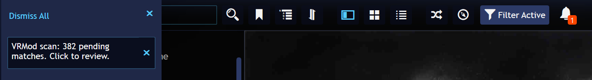

# VRMod Tags — User Manual

**VRMod Tags** is a Playnite add-on that finds VR mods, ports, and conversions for the
games in your library. It matches your games against twelve community-curated
sources (PCVR Central, UeVR Profiles, RototRobot VRMods-List, PCVR Mods Installer
Hub, CompoundVR, Mr Survivor VR HUB, Steam Curator “UEVR Compatibility”,
Steam Curator “VorpX Games”, REFramework, and Flat2VR Studios), plus two opt-in
sources — VorpX and Luke Ross (R.E.A.L. VR) — that are disabled by default and stay
out of every scan until you enable them in the settings. For every match you accept, it tags the game with
`VRMod` (plus category tags) and adds a link to the mod page, so VR-playable games are
always easy to find.

## Quick start

1. **Install** — download the latest release package (`.pext`) from the project's
   GitHub Releases page and double-click it. Playnite asks for confirmation and installs
   the add-on; a restart is required (the package is applied on the next startup).
2. **First scan** — Playnite starts scanning right after the restart. When the scan
   finds matches, Playnite posts a notification — the bell in the title bar gets a badge
   and the panel says:

   

   "VRMod scan: 382 pending matches. Click to review." — clicking it opens the review
   dialog.
3. **Review** — go through the suggested matches in the review dialog: accept the ones
   that are right, reject the false positives, and click **Save**. Accepted games get
   tagged (and linked), and your decisions are remembered — later scans won't ask about
   them again.

## Pages

| Page | What it covers |
| ----- | -------------- |
| [Getting started](getting-started.md) | Installation, what happens on install and first scan, automatic scans, the bell notification, updating, uninstalling. |
| [Review dialog](review.md) | Every column, the status values, accept/reject, filters, sorting, the columns menu, bulk actions, and resetting all decisions. |
| [Settings](settings.md) | The Sources grid column by column, source health, the fuzzy-match threshold, scan interval, cache duration, and the Help button. |
| [Tags & data sources](tags.md) | Every tag the plugin can apply, what it means, and the community sources this plugin is built on. |
| [For developers](for-developers.md) | Where the developer documentation lives. |
