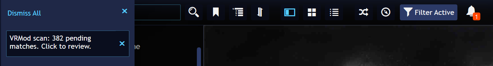
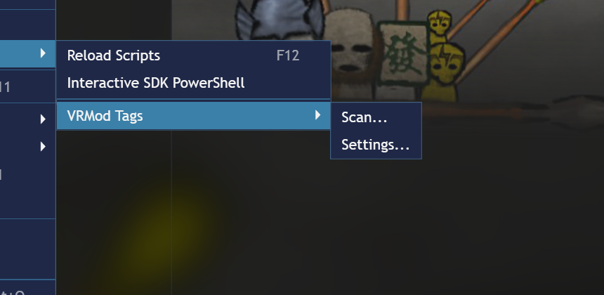
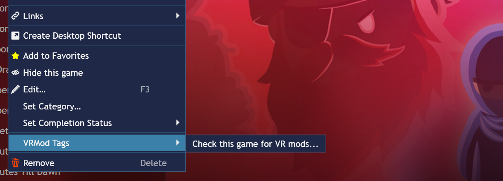

# Getting started

## Installing

1. Download the latest release package (`VRMod.Tags-<version>.pext`)
   from the project's GitHub Releases page. The name GitHub
   serves the download under is spelled with a dot, not a space.
2. Double-click the package. Playnite registers itself as the handler
   for `.pext` files, asks for confirmation, and installs the add-on.
3. Restart Playnite — the package is applied on the next startup.

You'll find the plugin's settings page in the **Add-ons** window (press **F9**
or click the **Add-ons** icon in Playnite's toolbar) under
**Extensions settings** → **Metadata Sources** → **VRMod Tags**.

> **Note:** this is *not* Playnite's main **Settings** window. Add-on settings
> are not listed there — the only place to configure this plugin is the
> **Add-ons** window.

## What happens on install and on the first scan

Installing the add-on doesn't change anything in your library yet.
As soon as Playnite starts with the add-on installed, it runs a scan:

- It downloads the listing of every **enabled** source (the
  first run does the downloads; afterwards each listing is cached
  for the duration you configure, so normal starts are fast).
- It matches every listing against your library. Matching is
  exact first (a Steam App ID match is preferred whenever the
  source has one), then by normalized game name with a similarity
  threshold (the default is 80% — see [Settings](settings.md)).
- Nothing is written to a game before you agree to it. An exact match (score
  1.00) arrives in the review dialog already marked as a yes, so confirming it
  is one press of **Save**; everything else starts as **Pending**. A pairing you
  have not saved gets no tags and no link.

When the scan finds matches, Playnite posts a notification —
the bell in the title bar gets a badge and the panel says:

"VRMod scan: 382 pending matches. Click to review." Every notification
is **clickable**: new pending matches — or tag changes on matches
you already saved — open the review dialog. A scan that finds nothing
new posts no notification at all — the per-source status in the
settings page says what happened (e.g. a source that returned no data).

## Automatic scans

The plugin scans automatically:

- **at Playnite startup**,
- **when you add a game to your library** — that game is scanned in the
  background, with no window: the tags your saved decisions back are written,
  and a pairing nobody was asked about is left alone until you review it,
- **on a schedule you configure** — the default
  is every 7 days; see [Settings](settings.md).

What a scan does does not depend on what started it: a pairing you **accepted**
gets its tags and its link, a pairing you **rejected** gets nothing, and a
pairing nobody has been asked about gets nothing either — it waits in the review
list. A tag therefore always means "you agreed to this mod for this game".

The startup and scheduled scans report their findings in the bell; clicking it
opens the review dialog — the pending matches, or every matched game when your
saved matches picked up tag changes. A scan that finds nothing new stays silent,
and the per-source status on the settings page says what happened. The new-game
scan posts no bell: reach the result yourself with the game's own menu (see
[Menus](#menus)) or the review dialog.

You can also open the review dialog any time from the settings page: the
**Review VR Mods** button opens it directly from the data of your last scan
(without rescanning) — with every matched game (new and already-decided), so you
can review or change your decisions; the **Full Scan** button rescans every
enabled source and re-applies what your saved decisions back, without a dialog —
the fast "update my tags" action. Pairings you never decided are not applied by
it; they wait in the review list.

## When a source is down, or you cancel a scan

A scan that cannot reach one of its sources does not stop. The sources that
answered are matched and applied as usual, so the mods you already agreed to keep
their tags and their links. What such a scan will not do is take anything off:
removing tags and links happens only after a scan in which every enabled source
answered. Otherwise a site being offline for an afternoon would read as "these
mods no longer exist". The next scan where everything answers does the cleanup it
skipped. The failed source is the red row in the [sources
list](settings.md#sources); its **Last run** button names the reason.

Cancelling is a different thing. The progress window of a manual scan (**Scan...**
in the Extensions menu, **Full Scan** in the settings page) has a **Cancel**
button. Cancel while the sources are still answering — the long part of a scan —
and it stops before writing anything: no tags, no links, no review dialog, and
whatever earlier scans applied stays as it was. That is the one point where a
cancel is looked for, so once every source has answered the scan finishes its
local work and writes what it found; a click after that cannot take it back. The
automatic scans (startup, schedule, a new game) have no window, so there is
nothing to cancel.

## Menus

The plugin adds two submenus to Playnite, both titled **VRMod Tags** — one under
the main menu's **Extensions**, one in the context menu of a game or selection.

Anything you start from these menus answers in a **window**: a menu closes the
moment you click it, so a result with nothing else on screen to carry it would
never arrive. The bell is reserved for the scans you did not start — startup,
the schedule, a new game (see [Automatic scans](#automatic-scans)). When
something did not work, the window says so and the cause is in Playnite's
`extensions.log`, next to `Playnite.dll`.

### Extensions → VRMod Tags

- **Scan...** — scans the whole library and ends in the review dialog, showing
  every matched game: what this scan found, your accepted and rejected pairings,
  and everything still waiting for you. When no mod in the sources fits any game
  in your library, a window says that instead of an empty dialog; when the scan
  does not finish, the window says so, and `extensions.log` holds the cause.
- **Settings...** — opens this plugin's page in the **Add-ons** window (see the
  note under [Installing](#installing): add-on settings are not in Playnite's
  main **Settings** window). The item is not offered in fullscreen mode, where
  there is no settings page to open.

### Right-click a game → VRMod Tags

The labels count your selection, so a multi-selection reads "these 4 games"
where one game reads "this game".

- **Check this game for VR mods...** — scans only the selected games and opens
  their review list. Always offered. When those games have no mod, it says so in
  a window rather than a bell; and when a scan is already running (or no source
  is enabled) it says the scan did not start, rather than opening an empty
  window.
- **Reset my decisions for this game...** — offered when the plugin holds a
  saved decision (accepted, rejected, or merely asked) for at least one selected
  game. It forgets those decisions *and* removes the tags and links they had put
  on those games, in one action, so a game keeps nothing the plugin no longer
  stands behind. The next scan offers the mods for review again — which makes
  this also the way back from a reject.
- **Reject all assigned VR mods on this game...** — offered when the plugin
  holds an accepted pairing for at least one selected game. The mods assigned to
  those games are refused: their tags and links come off now, and the plugin will
  not offer them again. Other mods that fit the game are still suggested — the
  veto is per mod and per game, not a ban on the game.

The last two ask for confirmation first, and the confirmation says what will be
removed and how to undo it. Neither one touches a tag the plugin did not add: your
own tags and links stay yours. Every route by which a tag comes back off — the
two above, the review dialog, a source you switch off, and what a full scan does
when a mod's listing disappears — is in
[Tags & data sources](tags.md#how-a-tag-comes-off-again).

The menu items appear only where they can do something — which is why a game with
no VR mod of yours in it shows only **Check this game for VR mods...**.

One
state asks for that separately: a game tagged by an **older** version of the
plugin, which could tag a match it had never asked you about, carries tags with
no saved decision behind them. For such a game the two decision items do not
appear, because there is no decision to reset or refuse; **Check this game for VR
mods...** lists it, and deciding its row in the dialog gives it a decision — from
then on the menu treats it like any other game. The current version never
creates that state.

Everything a menu does to one game, the review dialog does to a whole set at
once — see [Review dialog](review.md).

## Updating

Double-click the new `.pext` — the same flow as the first install.
Your settings and your saved decisions survive the update.

## Uninstalling

Remove "VRMod Tags" from Playnite's **Add-ons** window, then restart Playnite.
The plugin detects the queued uninstall as Playnite shuts down and removes
everything it added: all `VRMod*` tags from your games, the source links on
matched games, the `VRMod*` tag definitions, and its own settings file. Playnite
then deletes the plugin files on startup — nothing of the plugin is left behind.
