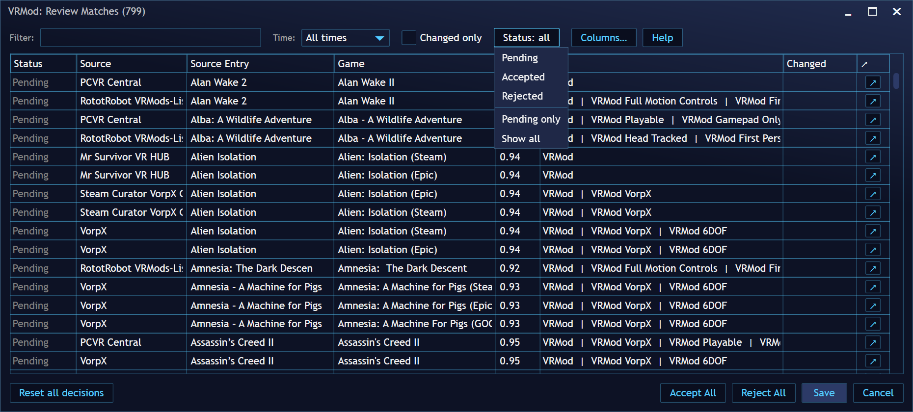
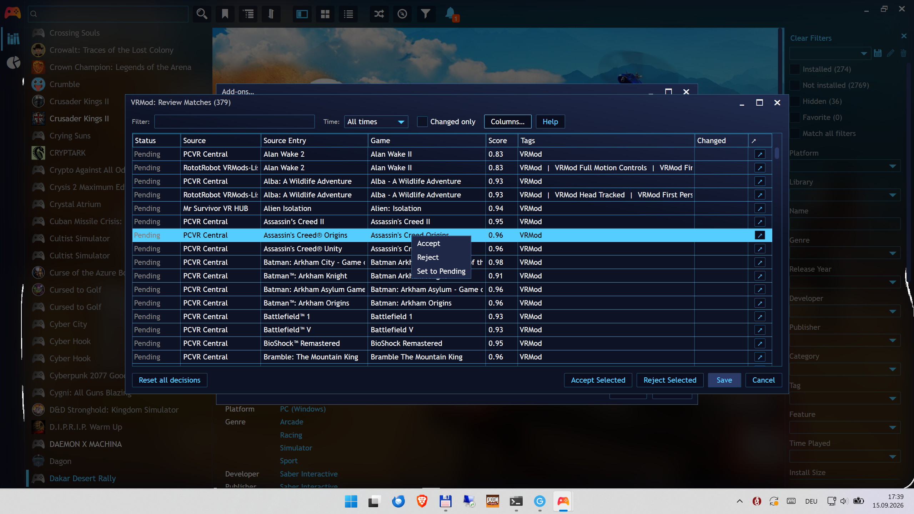
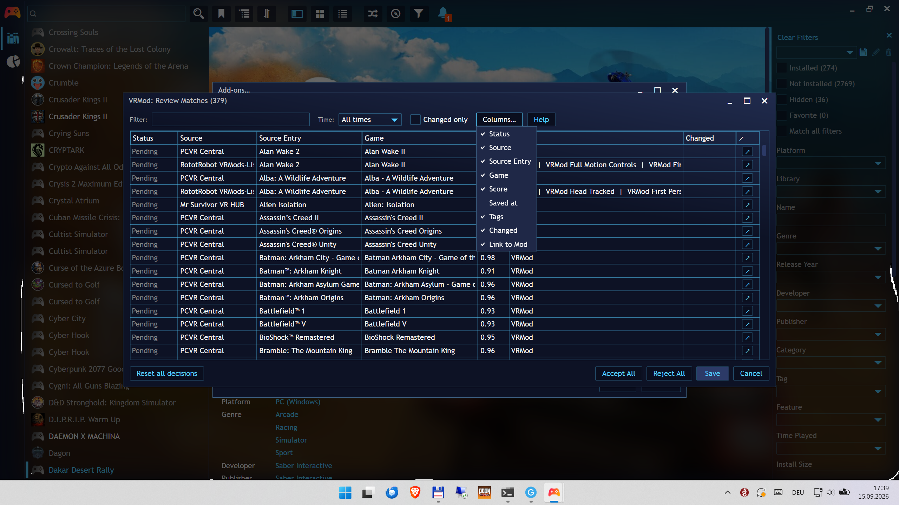

# Review dialog

The review dialog is where you decide which suggested matches are right. You open it:

- from the **Review VR Mods** button on the settings page — without rescanning (it
  uses the data of your last scan), it lists every matched game (new and
  already-decided), pending first, so you can review or change your decisions;
- from the bell notification — the pending matches when there are new ones,
  or every matched game when your saved matches picked up tag changes (a scan
  that found nothing new posts no notification at all).

## Columns

| Column | What it shows |
| ----- | ----- |
| **Status** | The decision for this match: **Saved** or **New** (accepted), **Rejected** or **Rejected (new)**, **Suggested**, or **Pending**. The status is *italic* while the decision has not yet been saved to your library. |
| **Source** | Which source the match came from. |
| **Source Entry** | The entry in that source's listing. |
| **Game** | The game in your library the entry matched. When the same title is in your library more than once (for example imported from Steam and from Epic), each import is its own row, shown with its store name in brackets. |
| **Score** | Match confidence — 1.00 is an exact match (exact matches are accepted by default). |
| **Saved at** | When the current decision was saved. Hidden by default — enable it via the **Columns…** menu. |
| **Tags** | The tags the game gets when you accept: the `VRMod` umbrella tag plus the category tags. Italic with an "↑" marker when the source's tags changed since you last accepted. |
| **Changed** | Flagged when the source's tags changed since your last acceptance (for example, 6DOF support added to the listing later). Tick **Changed only** to filter to just those rows. |
| **Link to Mod** | The "↗" button opens the mod page for that entry in your browser. |

## Suggested rows

A **Suggested** row is a source listing and a library game where **one name is the other name with
words added**: *Morrowind* against *The Elder Scrolls III: Morrowind GOTY Edition*, *Trine 2* against
*Trine 2: Complete Story*, *We Were Here* against *We Were Here Together*. The words in common line
up in order, and what is added is either re-release packaging (`GOTY`, `Complete Edition`, a franchise
prefix) or wording the name rules cannot judge. The plugin never tags such a pairing on its own,
because "is this the same product or a different release of it" is your call, not a string metric's.

A disagreement is **not** suggested. If the two names carry different numbers (*Age of Wonders 3*
against *Age of Wonders 4*) or disagree about an edition word, the pair is refused and never reaches
the review grid at all — those rows would be noise, and a wrong Accept there would write tags for the
wrong game.

- Hover the **Status** cell to read the reason: which words of the listing name the game name
  contains, which words of the game name are left over, and whether a number disagrees.
- Accepting the row records the pairing by name. Every later scan then matches that listing to
  that game whatever either is called — for that listing and that game only, so a sibling sequel
  is not dragged in.
- Suggestions are never applied by a scan, and they are never counted as matches. Accept one and
  the tags appear at the next save.

## Making decisions

- **Double-click a row** to cycle its status: Pending → Accepted → Rejected.
- **Right-click a row** for a quick menu: **Accept**, **Reject**, **Set to Pending**.

  
- **Keyboard** (with the list focused): **Enter** accepts the row, **R** rejects it, and
  **P** sets it to Pending — handy for reviewing row by row with the arrow keys. **Ctrl+S**
  saves (the **Save** button is no longer the Enter default).
- **Alt accelerators** (from anywhere in the dialog): **Alt+F** the filter box, **Alt+T** the
  time window, **Alt+S** the status menu, **Alt+C** the columns menu, **Alt+H** the help, and
  **Alt+A** / **Alt+R** accept / reject directly (the selected rows, or every match when none
  are selected). Each control also shows its accelerator in its tooltip.

- **Bulk buttons** (bottom right): with no row selected, **Accept All** / **Reject All**
  act on everything; with one or more rows selected they become **Accept Selected** /
  **Reject Selected** and act on the selection.
- A decision you change in the dialog is *italic* in the **Status** column until you
  click **Save** — **Save** persists every changed decision to your library (tags and
  links are applied), **Cancel** closes the dialog and discards the unsaved changes.
  **Save** is disabled while everything is already saved. The **×** in the title bar
  also closes without saving.

The dialog is a normal Playnite window: it can be minimized, maximized, and resized
from the edges.

## Finding rows

- **Filter** box — text filter over the list.
- **Time** filter — All times / Last hour / Last day / Last week / Last month.
- **Status** filter — show only rows with the chosen decision. The dropdown lists
  **Pending** / **Accepted** / **Rejected** (tick several for a union); **Pending only**
  and **Show all** are one-click shortcuts. "Status: all" (nothing ticked) shows
  everything.
- **Changed only** — show only rows whose tags changed since your last acceptance.
- **Sorting** — click a column header to sort by it.
- **Columns…** menu — show and hide columns; a column can be reordered by dragging its
  header.

  

## Reset all decisions

**Reset all decisions** (bottom left) clears every decision so all matches are reviewed
again. It asks what to do with the tags:

- **Reset only** — keep the tags already applied to your games;
- **Reset and remove tags** — also remove every `VRMod*` tag from your library.
