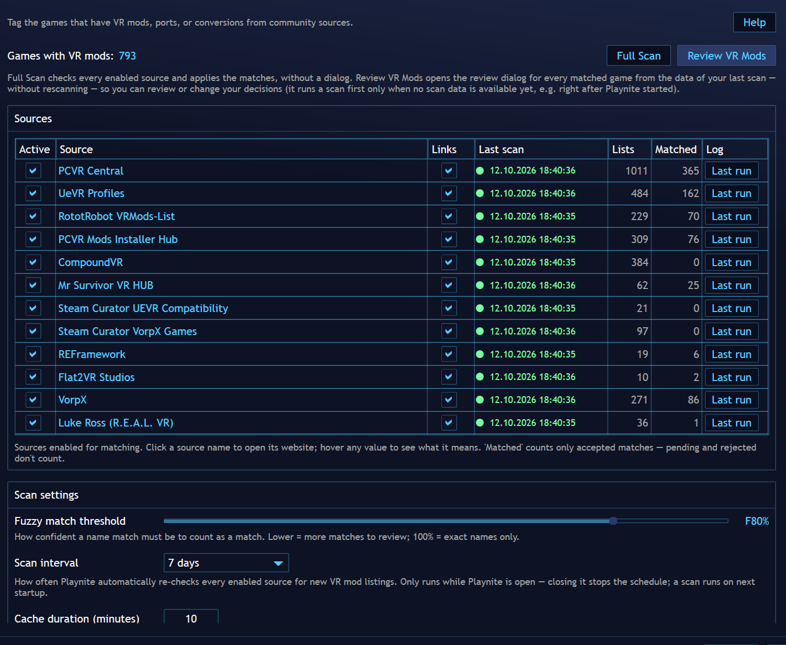

# Settings

The settings page lives in Playnite's **Add-ons** window (press **F9** or use
the **Add-ons** toolbar icon), under **Extensions settings** →
**Metadata Sources** → **VRMod Tags**. Playnite's main **Settings** window does
*not* contain add-on settings — if you don't see the plugin there, you're in
the wrong window.

## Top of the page

- **Games with VR mods: N** — how many games in your library currently carry a `VRMod`
  tag.
- **Full Scan** — checks every enabled source and applies the matches right away,
  without a dialog (the fast "update my tags" action).
- **Review VR Mods** — opens the review dialog for every matched game (new and
  already-decided) so you can review or change your decisions. It opens instantly from
  the data of your last scan — it does not rescan. Only when no scan data is available
  yet (right after Playnite started, before the first scan finished) it runs a scan
  first.
- **Help** (top right) — opens the user manual that ships inside the installed package,
  so the documentation always matches the version you have installed.

## Sources

One row per data source:

| Column | What it does |
| ----- | ----- |
| **Active** | The checkbox enables the source for matching. Unchecking it asks whether to also remove the tags that came from it (tags shared with other sources are kept). |
| **Source** | The source name — click it to open the source's website. |
| **Links** | The per-source link toggle: when an accepted match from this source is saved, the game gets a link to the source's page for it (or to the source's own site when it has no per-game page) in its **Links** section. Links follow the match: added when you accept, removed again if the match is later rejected, reverted to pending, the source is disabled, or this toggle is switched off. |
| **Last scan** | Health and time of the last scan. Green = healthy, orange = "No data" (the source answered normally but listed nothing), red = failed (a network error — timeout, DNS, refused connection — or the source returned an HTTP error status such as 404 or 503), gray = **Never scanned** (no scan has run in this Playnite session yet — e.g. an opt-in source that is still disabled). Hover the value for the full status. |
| **Lists** | How many games the source lists. |
| **Matched** | How many games have an *accepted* match from this source (pending and rejected don't count). |
| **Log** | A **Last run** button that opens a small dialog with this source's last scan: when it ran, the result (green = success, orange = "No data", red = failed — with the failure reason on the line directly below it: HTTP status code with its text (e.g. "HTTP 404 (Not Found)"), "request timed out after 30 s", or the socket error; transient failures — a refused or reset connection, a timeout, or HTTP 5xx / 429 — are retried automatically, up to 3 attempts with a short pause, each one recorded in the debug log, and a failure that still persists after all of them is named as such in the error line ("… (still failing after 3 attempts)")), how many entries it listed, how many of those carry tags / a source deep link (what the run *found*, independent of matching and apply), and a multiline, selectable **debug log** of the run (every web request with its HTTP status, per-game extraction problems, and what the apply phase actually applied — 0/0 when nothing was). Log and error are selectable so you can copy them. The data is in-memory, so it resets when Playnite restarts (a failed source re-fails on the next scan). A source with no scan yet in this session opens a short dialog that says so — "This source has not been scanned yet" — instead of a window with nothing in it. |

A source that fails (red) never takes other tags down with it: the scan continues for
the healthy sources and skips removing any stale tags that scan, so nothing is lost
while a source is down. The next healthy scan restores normal cleanup.

**VorpX** and **Luke Ross (R.E.A.L. VR)** are **opt-in** sources: they are **disabled by
default**, so on a fresh install their **Active** checkbox is unticked and they are not
scanned — or even fetched — until you enable them. They are capability/author lists rather
than general mod catalogs: VorpX is a single paid VR-driver product (its "catalog" is the
static list of games it supports), and R.E.A.L. VR is one mod author (the source is the
publicly listed subset of his games; the full list is Patreon-gated). Ticking **Active**
includes the source in the very next scan; **Save** keeps it enabled across Playnite
restarts. While disabled, the row reads **Never scanned** with 0 lists / 0 matched, and
the source takes no part in startup, scheduled, or **Full Scan** runs.

## Scan settings

- **Fuzzy match threshold** — how confident a name match must be to count as a match.
  Lower = more matches to review; 100% = exact names only. The default is 80%.
- **Scan interval** — how often Playnite automatically re-checks every enabled
  source for new VR mod listings. A preset ladder from 15 minutes to 30 days, plus
  **Never**. The default is 7 days. Only runs while Playnite is open —
  closing it stops the schedule; a scan runs on next startup.
- **Cache duration (minutes)** — how long a downloaded source listing is kept before the
  next scan re-downloads it (60 = 1 hour). The default is 10. Used by every scan
  (startup + scheduled + single-game on install), which only run while Playnite is open.
